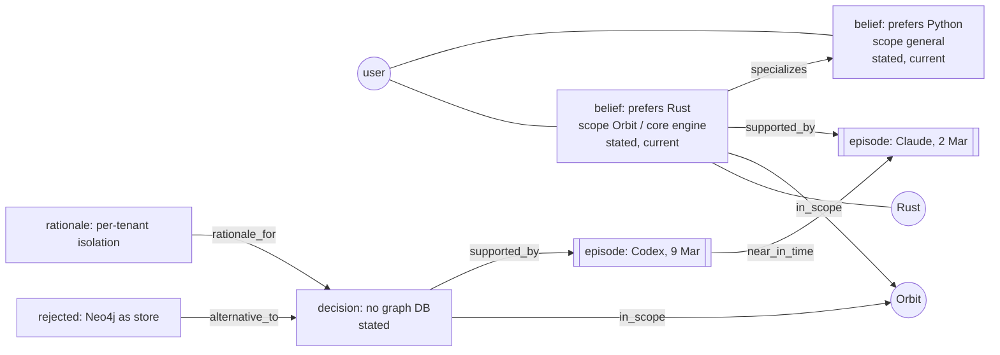

# 05 · The memory model

> **What this document decides:** the canonical representation of memory, the type rules that keep it honest, the taxonomy of memory kinds, and the shape of the knowledge graph. Table definitions are in [13-data-model](../system-design/13-data-model.md).

## 1. The Epistemic Ladder

Memory is stored in four layers. Each layer is derived from the one below, cites it, and can be thrown away and rebuilt from it.

| Layer | Contains | Mutability | Analogy |
|---|---|---|---|
| **L0 Evidence** | The exact bytes of what happened: conversation turns, documents, transcripts, tool output, with who/where/when | Append-only. Never edited. Removed only by the user | Hippocampal trace; an event log |
| **L1 Claims** | *Who asserted what, with what force*, anchored to byte spans in L0 | Immutable once written; can be retracted | An index entry; a witness statement |
| **L2 Beliefs** | *What Orbit currently holds to be the case*, per subject–predicate–scope, with validity in time, justified by claims | Never edited: a change closes one version and opens another | Semantic memory; a materialised state |
| **L3 Views** | Compiled, readable knowledge: identity card, project briefs, entity profiles, topic and period summaries, procedures. Every sentence cites beliefs | Disposable; regenerated when what they cite changes | Schemas and gist |

Two rules govern movement on the ladder:

1. **Nothing moves up without a recorded justification.** A claim has anchors; a belief has claims; a view sentence has beliefs.
2. **Nothing is edited in place.** Lower layers are immutable; upper layers are versioned.

**The distinction that matters most is between L1 and L2.** A claim records that something *was said*. A belief records what Orbit *takes to be true now*. Almost every memory system merges the two, which is why they cannot handle "I told Claude something wrong and corrected it in Codex" (two claims, one retracted belief), or an assistant's suggestion the user never accepted (a claim by the assistant, no belief about the user), or a preference that holds in one project and not another (two beliefs, different scope).

### Worked example

The user types, in Claude Desktop on 2 March 2026:

> I prefer Rust for the core Orbit engine because I want predictable performance and strong control over system resources.

| Layer | What is stored |
|---|---|
| **L0** | `ev_91…`: the sentence, byte-exact; author `user`; source = a Claude Desktop conversation; `occurred_at` 2026-03-02T14:11Z; integrity `user_direct`; SHA-256 of the content |
| **L1** | `cl_a1…` — speaker `user`, act `prefer`, subject *user*, predicate `preferred_language`, object *Rust*, scope `{project: Orbit, component: core engine}`, explicit, anchor = bytes 0–39 of `ev_91…` |
| | `cl_a2…`, `cl_a3…` — act `rationale` for `cl_a1…`: "predictable performance", "strong control over system resources", each anchored |
| | literal `lt_7c…` = `Rust`, kind `term`, anchored at bytes 9–13 |
| **L2** | `bl_55…` — kind `project.stack_preference`; *user* `preferred_language` *Rust* in scope `{Orbit / core engine}`; valid from 2026-03-02, open-ended; **basis `stated`**, standing `unconfirmed`, lifecycle `current`; supported by `cl_a1…`; rationale `cl_a2…`, `cl_a3…`; integrity `user_direct` |
| | *Not created:* a decision "the core engine is written in Rust". The user stated a preference. If the extractor proposes the decision, it is stored with basis `inferred` and waits for evidence |
| **L3** | Orbit's project brief, section *Stack*: "Core engine: ⟦Rust⟧ preferred — predictable performance, control over system resources. ⟦bl_55…⟧" |

The original sentence is never touched, and any later rendering of "Rust" is a copy of those four bytes ([06](06-memory-formation.md#5-exactness-anchors-and-handles)).

## 2. The canonical unit

There are two, and they answer different questions.

- **The unit of truth is the evidence span.** If an anchor does not resolve to bytes whose hash matches, nothing built on it is served.
- **The unit of knowledge is the belief version**: `(subject, predicate, object, scope, valid-time, system-time, basis, standing, justification)`. It is what is retrieved, ranked, versioned, permissioned and shown to the user.

This is deliberately the shape of a Wikidata statement — value, qualifiers, references, rank — which is the longest-running public example of a knowledge base that holds contradictory, time-qualified, multi-source statements without losing track of who said what.

**Alternatives considered.** *Atomic facts only* (lossy, no force or scope). *Documents/chunks only* (no state, no revision). *Graph triples* (no qualifiers without reification; nuance lost). *Episodes only* (no consolidated state). The ladder keeps all four as layers instead of choosing one.

## 3. Type rules

Every claim and belief carries labels that are computed, not written by a model.

### 3.1 How we know: `basis`

| Basis | Meaning | Requires |
|---|---|---|
| `stated` | The user said it | ≥ 1 **explicit** claim by the user, at integrity `user_direct` or `user_artifact` |
| `observed` | Seen in an artefact the user controls (a lockfile, a config, a commit) | Anchor in `user_artifact` evidence |
| `reported` | Someone or something else said it: an assistant, a web page, another person; or an AI relaying the user's words through a write tool | Any anchored claim |
| `inferred` | Orbit derived it | A recorded derivation with ≥ *k* independent supporting observations |
| `assumed` | A weak default: a single implicit cue, or an unratified assistant suggestion | Any anchor |

**The ratchet (INV-5).** Basis rises only on new evidence of the required kind. It does not rise because a model is confident, because the same derived text was regenerated, or because Orbit's own output came back through a conversation ([Echo Guard](07-consolidation.md#4-echo-guard)).

**Ratification.** In AI conversations the content is often the assistant's and the commitment the user's ("yes, let's do that"). Such a belief is `stated` only when a user-authored span ratifies the assistant's proposal; the claim carries both anchors. Silence is not ratification.

### 3.2 How settled: `standing`

`confirmed` (explicitly confirmed by the user, or stated on ≥ 2 independent occasions) · `unconfirmed` · `disputed` (unresolved conflicting support — both sides are kept and shown).

### 3.3 Where in its life: `lifecycle`

`current` · `superseded` (was true, no longer; valid-time closed) · `retracted` (was never right, or lost all support; system-time closed) · `expired` (a transient state whose time ran out).

### 3.4 How far to trust the channel: `integrity`

| Level | Channel |
|---|---|
| `user_direct` | Typed or spoken by the user in a channel Orbit captures itself or through a trusted connector; edits in Orbit's own UI |
| `user_artifact` | Documents and repositories the user authored or controls |
| `user_relayed` | An AI client quoting the user through a write tool — plausible, unverifiable |
| `agent` | Assistant-authored text and summaries; tool output |
| `external` | Web pages, third-party documents, other people's messages |

A belief's integrity is the **minimum** over the claims it needs. Kinds that define the user or instruct future agents have a floor:

| Belief kind | Minimum integrity to be served as fact |
|---|---|
| `identity.*`, `procedural.*`, project conventions | `user_direct` or `user_artifact` (or `user_relayed` + user confirmation) |
| `project.decision`, `project.goal`, `prospective.*` | `user_relayed` |
| `semantic.*`, `relation.*` | any — but rendered with its basis |

This is the Biba integrity model (no write-up) applied to memory, and it is the main defence against poisoning ([11](11-security-privacy.md)).

### 3.5 Who may see it: `sensitivity` and compartments

`public` · `work` · `personal` · `sensitive` (health, finance, sexuality, politics, religion, precise location, minors). Credentials are a separate class that never enters memory. A belief's sensitivity is the **maximum** over its supports. Compartments are projects plus named groups (`personal`, `family`, `employer:…`). Grants are expressed over kinds, compartments and a sensitivity ceiling.

## 4. Two timelines

Each belief version has two intervals:

- **Valid time** — when it holds in the world, as far as known (`[2026-03-02, ∞)`).
- **System time** — when Orbit held this version (`[2026-03-02T14:11Z, ∞)`).

| Event | Valid time | System time |
|---|---|---|
| Something *changed* ("I've switched to Go") | Old version's valid interval closes; new one opens | Both versions remain believed |
| Something was *wrong* ("no, I never said Python") | — | Old version's system interval closes (`retracted`); a corrected version is asserted, possibly valid retroactively |
| *Late* evidence arrives (an imported 2024 chat) | Inserted where it belongs in valid time | Recorded now — and it does **not** override newer statements |

This supports three query forms: *what is true now*, *what was true on date D*, and *what did Orbit believe on date D* (for audit). The third is what makes "why did the agent do that last month?" answerable.

## 5. Scope: beliefs are defaults with exceptions

A belief's `scope` is a set of constraints — project, component, domain, activity, audience, environment. Scopes are ordered by specificity: `{Orbit, core engine}` is narrower than `{Orbit}`, which is narrower than `{}`.

For a given context, the applicable belief is the **most specific current one whose scope the context satisfies**; ties go to the later valid-from, then the higher basis. This is the specificity principle from defeasible reasoning, and it is what lets these coexist without contradiction:

| Belief | Scope | Valid from |
|---|---|---|
| prefers **Python** | `{}` (general) | May 2026 |
| prefers **Rust** | `{domain: systems programming}` | Nov 2026 |

A coding agent working on Orbit's engine is told Rust; a data-analysis chat is told Python; "what was my original preference?" returns the first with its date. Nothing was overwritten.

A **predicate registry** records, per predicate: cardinality (`functional` — one value per scope at a time — or `multi`), temporality (`fluent` or `rigid`), value type, default kind, default sensitivity and integrity floor. It starts small and curated and grows by canonicalising new predicates the extractor proposes; mappings are derived and reversible.

## 6. Taxonomy: seven memory types on one substrate

| Type | Where it lives | Belief kinds | Special rules |
|---|---|---|---|
| **Identity** | Beliefs about the *user* entity; L3 identity card | `identity.{trait, value, belief, preference, style, strength, weakness, interest, aspiration, principle, tendency}` | Stability estimate (state / phase / trait); high integrity floor; sensitive categories are never *inferred* without opt-in |
| **Episodic** | L0 evidence grouped into **episodes**, with L1 claims as the index | — | Reconstructed from evidence, not summarised into facts |
| **Semantic** | Beliefs about concepts and the world as the user has encountered them; L3 topic summaries | `semantic.{fact, definition, concept, explanation, idea}` | Orbit records *that the user learned or thought X, when and from where* — it is not an encyclopaedia. Usually `reported`; the user's own ideas are `stated` |
| **Project** | A *project* entity, beliefs scoped to it, L3 briefs | `project.{purpose, goal, constraint, architecture, stack, decision, rejected_approach, open_question, issue, task, milestone, convention, glossary, artifact, command, dependency, stakeholder}` | See [09](09-project-memory.md) |
| **Procedural** | Beliefs about how the user works; L3 procedures | `procedural.{workflow, convention, tool_preference, heuristic}` | Functions as instructions to future agents → highest integrity floor; induced patterns need ≥ 3 independent episodes and stay `inferred` until confirmed |
| **Relationship** | Entities and reified relations between them | `relation.{works_on, uses, part_of, member_of, knows, reports_to, depends_on, discussed_in, …}` | Each relation has validity in time |
| **Working** | The workspace (a separate, small, fast store) | focus · task · open question · recent decision · handoff · observation | Bounded (≈ 5 foci), decays in hours, holds *pointers* into long-term memory |

An eighth, **prospective** memory (`prospective.intention` + a trigger), is included because the brief asks for it and because it is the seed of the autonomy layer.

## 7. Entities and soft identity

An entity is a node with a type (person, organisation, project, component, technology, product, place, event, concept, artifact, term), a canonical name, aliases, external identifiers (git remote, package coordinates, URL) and attributes held as beliefs.

**Resolution is non-destructive.** Mentions link to entities; "these two are the same thing" is a `same_as` assertion with a confidence and an author (system or user). The resolved cluster is computed from those assertions, so a bad merge is undone by retracting an assertion, not by repairing data. User assertions (`same_as`, `different_from`) are absolute.

**Confusables.** Names that look alike and are not the same — `pgvector` / `pgvecto.rs`, `Graphiti` / `GraphRAG`, version 1.8 / 18 — get an explicit `confusable_with` link, detected by string similarity combined with differing identifiers. Retrieval uses it for a lure check: before a name is returned as an answer, the cited evidence must contain that name's surface form. This is pattern separation, implemented as a lookup.

**Versions** are qualifiers on mentions and claims by default (`PostgreSQL` + version `18`), promoted to child entities only when they accumulate their own facts.

## 8. Knowledge graph

The graph is **derived** from the tables and held in memory per user ([12](../system-design/12-system-design.md#5-brain-image)). It is an index for association, not a store.

**Nodes:** entity · belief · episode · view · project/scope · literal.

**Facts are reified.** A relationship between two entities is a *belief node* connected to both, so it can carry scope, validity, basis and provenance. A bare `(A)-[uses]->(B)` edge could carry none of them.

| Edge | From → to | Meaning |
|---|---|---|
| `about` | belief → entity | Subject or object role |
| `mentions` | episode → entity / literal | Weighted by salience |
| `supported_by` | belief → episode | Through its claims |
| `in_scope` | belief → project / component | |
| `part_of` | episode → general event → period; component → project | Hierarchy |
| `next`, `near_in_time` | episode → episode | Same thread; temporal contiguity across sources |
| `supersedes`, `refines`, `specializes` | belief → belief | Lineage |
| `contradicts` | belief ↔ belief | Disputed pairs |
| `rationale_for`, `alternative_to`, `depends_on` | belief → belief | Decision structure |
| `associated` | any ↔ any | Learned: co-use, or discovered during consolidation; always `inferred` |
| `same_as`, `confusable_with` | entity ↔ entity | Identity |

Every edge has a weight, a validity interval and the integrity, sensitivity and compartment needed to mask it per client.

The *user* node touches almost everything, so it is excluded from traversal; otherwise every memory would be two hops from every other.

## 9. Episodes

An episode is a bounded, coherent stretch of experience — a conversation or a topical segment of one, a meeting, a work session — with a time interval, participants, setting (client, model, project, device), its ordered evidence and a derived summary. Episodes nest (session → episode) and roll up into general events and periods, following the structure of autobiographical memory. Boundaries are placed at topic or goal shifts, not at token counts ([06](06-memory-formation.md#3-segmentation)).

Answering "what did I discuss with Claude about the Orbit architecture last September?" is therefore a filter over episodes (client family, time window, project, topic) followed by reconstruction from their evidence — not a similarity search over sentences.

## 10. Human-readable and machine-readable

Every belief and view is stored once, as a **template with handles** (`⟦lt:…⟧` for exact strings, `⟦en:…⟧` for entity names, `⟦bl:…⟧` for citations), and rendered two ways: structured JSON for machines, Markdown for people. The Orbit UI, an exported `AGENTS.md` and an MCP tool result are three renderings of the same rows.

## 11. Decisions

| Decision | Alternatives | Why this | Cost | Test |
|---|---|---|---|---|
| Separate claims from beliefs | Single "memory" record | Corrections, ratification, attribution and deletion all need the distinction | Two tables, one more join | Correction / attribution / erasure suites |
| Bitemporal versions | Overwrite; single timestamp | Change ≠ correction; late imports; audit | More rows; interval logic | As-of and late-arrival tests |
| Scoped defaults | Global facts; last-write-wins | Preferences are contextual | Scope inference can be wrong | Scoped-preference suite |
| Computed basis and confidence | Model self-report | Self-reported confidence is uncalibrated and cannot be audited | Needs calibration data | Reliability diagrams |
| Reified facts, derived graph | Graph DB as store | Qualifiers and provenance on every fact; one source of truth | Projection lag (seconds) | Graph-vs-table consistency check |
| Soft entity identity | Destructive merge | Merges are the most damaging silent error | Clustering at read/projection time | Merge/split reversal test |
