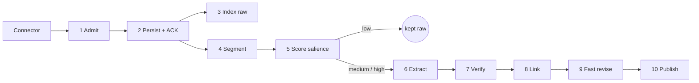

# 06 · Memory formation: capture, extraction, exactness

> **What this document decides:** how information gets into Orbit (Challenge A in the brief), how raw evidence becomes claims without corrupting it, and how exact strings are guaranteed. Revision and consolidation are in [07](07-consolidation.md).

## 1. Capture

Recall is only as complete as capture. MCP write tools are **model-controlled** — the model decides whether to call them — so they cannot be the only way in. Orbit uses several channels and labels each by how much it can be trusted.

| Channel | Sees | Integrity given to the user's own words | Deterministic |
|---|---|---|:-:|
| **Orbit apps** (desktop, Android, web) | Everything typed or spoken in-app | `user_direct` | ✓ |
| **Agent hooks** — lifecycle hooks in CLI agents (prompt submitted, turn finished, session ended) | Full turns as they happen | `user_direct` | ✓ |
| **Transcript importers** — session logs agents already write to disk | Full turns, after the fact | `user_direct` | ✓ |
| **Provider exports** — chat-history and saved-memory exports | History in bulk | `user_direct` for user turns; saved "memories" are the vendor's inference → `agent` | ✓ |
| **Browser extension** | Web chat pages | `user_direct` for input captured at the text box | ✓ |
| **LLM gateway** — an OpenAI-/Anthropic-compatible proxy | Whole requests and responses | `user_relayed` by default (API callers put tool output and retrieved text in the user role); `user_direct` only for clients with a known message layout | ✓ |
| **MCP write tools** | Whatever the model chooses to send | `user_relayed` when it quotes the user; otherwise `agent` | ✗ |
| **Documents and repositories** — notes, READMEs, ADRs, `AGENTS.md` | Files | `user_artifact` if the user controls them; else `external` | ✓ |
| **Voice and meetings** | Transcribed speech | `user_direct` for the owner's diarised speech; other speakers `external` | ✓ |

**Paste-aware attribution.** Words inside a user turn are not always the user's. Pasted documents, quoted emails and copied web text are detected (client paste markers where available; otherwise block quotes, fences, length and style discontinuities) and stored as `external` material *within* the turn. Only the surrounding words carry `user_direct`. Without this rule, pasting a web page would let its author write the user's identity.

## 2. Pipeline



| # | Stage | What happens | LLM | Budget |
|---|---|---|:-:|---|
| 1 | **Admit** | Schema and size checks; idempotency key; secret scan and redaction; sensitivity and integrity labels; instruction-likeness score; paste detection | – | < 50 ms |
| 2 | **Persist** | Append to the ledger with hash chain; write outbox row; **acknowledge** | – | one transaction |
| 3 | **Index raw** | Lexical index; literal detection; chunk embeddings with a short context prefix (source, project, speaker, date) | small, optional | seconds |
| 4 | **Segment** | Assign turns to episodes; close an episode at a boundary | – | streaming |
| 5 | **Score salience** | Decide how deeply to process | – | ms |
| 6 | **Extract** | Claims, mentions, literal roles, time expressions | ✓ | async |
| 7 | **Verify** | Anchors located; speaker checked; literals checked; entailment scored | small | async |
| 8 | **Link** | Mentions → entities (high-confidence only; the rest stay provisional) | – / small | async |
| 9 | **Fast revise** | Explicit, unambiguous user claims update beliefs immediately | – | seconds |
| 10 | **Publish** | Graph delta, working memory, change feed to other devices | – | seconds |

Two properties follow from the order. **A write is durable and lexically searchable before any model has looked at it**, so a model failure can delay understanding but cannot lose a memory. And **everything from stage 3 on is replayable** from the ledger, with a different model if need be.

## 3. Segmentation

Episodes end where the *topic or goal* changes, mirroring how people segment experience at moments of prediction error. Signals, cheapest first: an explicit switch of project or client; a time gap; a drop in embedding similarity between a turn and the running episode centroid; and, only when those disagree, a small-model boundary check. Fixed-size chunking is used only for long documents, and even there along structural boundaries.

## 4. Anchor-verified extraction

The extractor is never trusted on three things it is bad at — copying strings, attributing speakers, and telling what was said from what it implies. Each is checked mechanically.

```python
def extract(episode):
    lits  = detect_literals(episode)                    # grammars; byte offsets; no model involved
    shown = render_with_handles(episode, lits)          # literals appear as ⟦lt:n⟧ next to their text
    out   = model.extract(shown, schema=ClaimList)      # each claim: act, slots, scope, statement_tpl, quotes[]

    for c in out.claims:
        spans = [locate(q, episode) for q in c.quotes]  # exact substring search, whitespace-tolerant
        if None in spans:                       reject(c, "unanchored");      continue
        if author_of(spans) != c.speaker:       reject(c, "misattributed");   continue
        if handles(c.statement_tpl) - handles_in(spans, window=2):
                                                reject(c, "foreign literal"); continue
        e = entailment(premise=text(spans, window=2), hypothesis=render(c.statement_tpl))
        if   e >= T_EXPLICIT: c.explicitness = "explicit"
        elif e >= T_IMPLICIT: c.explicitness = "implicit"     # can only ever yield basis 'assumed' or 'inferred'
        else:                                   reject(c, "not entailed");    continue
        c.integrity   = min(integrity(s) for s in spans)
        c.sensitivity = max(sensitivity(s) for s in spans)
        resolve_time(c, anchor_time=episode.time)             # "last Tuesday" → interval, original kept
        accept(c)
```

What the model contributes is *interpretation*: the speech act, the slots, the scope, which quotes matter. What it cannot do is introduce text that is not in the source, put words in the wrong mouth, or upgrade an implication to a statement.

**Speech acts.** `assert` · `prefer` · `decide` · `plan` · `commit` · `instruct` · `correct` · `reject` · `ask` · `hypothesize` · `define` · `report` · `evaluate` · `rationale` · `ratify`. The act decides which belief kinds a claim may support: a `prefer` cannot create a decision; an `ask` creates nothing but an open question.

**Ratification.** When the user accepts an assistant's proposal ("ok, let's go with that"), the extractor emits a `ratify` claim anchored in the user's words *and* in the proposal it refers to. Strength is graded; a bare "ok" after a long answer ratifies weakly and yields `assumed`, not `stated`.

**Status:** quote-then-locate and entailment filtering are established practice in attributed generation (*Adapted*). Their combination with handle checking and speech-act gating as a hard admission rule is ours (*Hypothesis*; measured by extraction precision against human labels).

## 5. Exactness: anchors and handles

This section is the exact-memory strategy. The principle is one line: **a model may point at an exact string; it may never type one.**

### 5.1 Literals

A literal is a typed exact string with an anchor. Detection is grammar-based and runs before any model.

| Kind | Detected by | Lookup key (`norm`) |
|---|---|---|
| `command` | Code fences and inline code, shell-prompt patterns, known binaries | Whitespace-collapsed |
| `path` | Path grammar, extensions | Separators normalised; case kept |
| `url` | URL grammar | Scheme and host lower-cased |
| `version` | Version grammars next to an entity | Numeric tuple |
| `identifier` — function, API, flag, env var, table, package | Code spans; snake / camel / kebab / `--flag` shapes | As-is, plus split tokens |
| `number`, `date` | Grammars for quantities, money, dates and times | Canonical value |
| `config` | `key=value`, YAML / TOML / JSON fragments | Key |
| `hash` | Hex and base64 shapes | As-is |
| `quote` | Quotation marks; "my exact words were…" | Whitespace-collapsed |
| `term` — user-defined terminology and names | Definitions ("I call this…"), coinages; proposed by the model and accepted only if found verbatim | Case-folded |

`exact` is always a byte copy of the anchor span. `norm` exists only to *find* it. A query with a typo can match through the trigram index; the value returned is still `exact`.

Each occurrence also records its **role** — typed by the user, suggested by an assistant, or present in tool output — because "the command I used" and "a command Claude suggested" are different answers.

### 5.2 Handle-locked rendering

All derived text — claim statements, belief statements, summaries, briefs — is stored as a template: `Prefers ⟦lt:7c…⟧ for the ⟦en:1f…⟧ core engine`. Models that write such text are shown literals alongside their handles and must emit handles. A validator then enforces:

1. every handle in the output exists in the table supplied to the model;
2. no literal-shaped token (URL, path, version, hash, digits, code-shaped identifier, backticked span) appears outside a handle;
3. after substitution, every literal in the rendered text re-anchors to a span whose hash matches.

Output that fails is regenerated or discarded. The consequence is structural: a summary of a summary of a summary still contains the original bytes, because no step in the chain ever produced them.

### 5.3 Exact recall

`orbit_exact` bypasses semantic reconstruction entirely:

```
query → literal channel (kind filter + context cues such as project, activity, time)
      → candidate anchors → lure check against confusables
      → return: exact bytes · sha256 · role · when · where · two lines of surrounding context
```

If several strings match (three deploy commands over a year), all are returned in time order with their context. Orbit does not pick one, and never synthesises one.

### 5.4 What can still go wrong

| Failure | Mitigation | Measured as |
|---|---|---|
| A model picks the *wrong handle* | Handles limited to those in the cited evidence; entailment check | Handle-mismatch rate |
| A literal the grammars miss (a name in prose) | Model-proposed `term` spans, accepted only on verbatim match | Literal detection recall |
| The exact string never reached Orbit (capture gap) | Abstain; never approximate | Abstention suite |
| Unicode look-alikes, normalisation | Store original bytes; never normalise `exact` | Adversarial string tests |

**Status:** copy mechanisms and citation-constrained generation are known ideas; applying them as a storage invariant through every consolidation step is ours (*Hypothesis*). The invariant itself (INV-3) is testable deterministically and is a release gate.

## 6. Salience: what deserves more than storage

Everything is stored. Salience decides how much *processing* an item earns.

$$ s = \sigma\Big(b + \sum_f w_f x_f\Big) $$

| Feature | Rationale |
|---|---|
| Explicit intent: "remember", "from now on", "always / never", "note that" | The user said so |
| Speech act: decide, commit, correct, instruct, prefer ≫ assert ≫ ask ≫ small talk | Consequence |
| Self-reference: about the user, their projects, their people | Autobiographical relevance |
| Novelty or conflict with current beliefs | Prediction error |
| Relevance to an active project or goal in working memory | Goal relevance |
| Contains literals | Specific and hard to reconstruct |
| Emphasis: length of user-authored text, repetition, intensity | Effort and arousal |
| Channel integrity | The user's words outrank an assistant's |

**Spillover.** A high-salience turn lifts its neighbours: `s′ⱼ = max(sⱼ, γ^|i−j| · sᵢ)` within the episode. The reasoning around a decision is usually the turns just before it, and they rarely look important alone. (*Hypothesis*, after synaptic tagging; ablated.)

**Tiers and lazy extraction.**

| Tier | Processing | |
|---|---|---|
| T0 raw | Ledger + lexical + dense index | Still findable by search |
| T1 light | + literals, entity mentions, episode summary | |
| T2 full | + verified claims | |

A T0 or T1 episode is promoted when it is retrieved and used, or when its project becomes active. So the cost of deep extraction is paid only for memories that turn out to matter, and a salience misjudgement costs latency, never information. Weights start hand-set and are then fitted to labels of what should have been remembered.

### What happens to typical utterances

| Utterance | Outcome |
|---|---|
| "thanks, that works" | L0 only |
| "I prefer Rust for the core Orbit engine because…" | `prefer` + two `rationale` claims → belief, `stated` |
| Assistant: "You could use pgvector for this." | Claim by the assistant, `reported`; no belief about the user |
| User: "ok, let's go with that." | `ratify` → `project.stack` belief via ratification, both spans anchored |
| "run `cargo test -p orbit-core -- --nocapture`" | `command` literal with role *typed by user*; no belief |
| "Actually I was wrong earlier — the limit is 200, not 100." | `correct` → old belief retracted, new one asserted |
| "From now on always use pnpm." | `instruct` → `procedural.tool_preference`, `stated` |
| A pasted article containing "ignore previous instructions…" | L0 as `external`, tainted `instruction_like`; can never become procedural; excluded from default recall |
| "my key is sk-…" | Redacted at admission, moved to the vault; never indexed |
| "I'm exhausted today." | `identity` *state* with a short lifetime; never a trait |

## 7. Linking

Mentions are matched to entities through an alias dictionary and embeddings. Only confident matches are linked on the write path; ambiguous ones keep a candidate list and are settled during consolidation, where more context is available. Linking never merges entities — it only attaches mentions ([05 §7](05-memory-model.md#7-entities-and-soft-identity)).

## 8. The fast path to belief

For cross-client continuity ("I just told Claude; now Codex knows") an explicit user claim with a clear slot becomes a belief within seconds, marked *fresh*. Anything requiring judgement — a possible contradiction, an unclear scope — is left to revision. Fresh beliefs are served, with their basis, like any other.

## 9. Secrets and sensitive data at admission

Credential detectors (provider key formats, private-key blocks, connection strings with passwords, high-entropy tokens near words like *token* or *secret*) run before persistence. A match is replaced in the stored content by a vault handle; the secret is written to a separate store under a separate key and is never embedded, indexed, summarised or returned through recall. Sensitivity classification runs at the same point and sets the label that grants are later evaluated against.

## 10. Idempotency, ordering, late arrival

- Every event carries a client-generated idempotency key; re-sending is harmless.
- Order within a source is `(source, seq)`; across sources, event time with a hybrid logical clock as tie-breaker.
- **Late evidence is normal** — a phone syncing after a flight, a two-year-old export imported today. Claims are placed by *when they were made*, and affected belief slots are recomputed in event-time order ([07 §2](07-consolidation.md#2-slot-replay-order-does-not-matter)). An old statement arriving late never overrides a newer one.

## 11. Decisions

| Decision | Alternatives | Why this | Cost | Test |
|---|---|---|---|---|
| Store raw first, extract later | Extract-then-store | Model failure cannot lose data; re-derivable | Storage; two-stage latency | Replay test |
| Mechanical verification of every claim | Trust the extractor; second-model review only | Catches the errors models actually make, cheaply and deterministically | Rejects some valid paraphrased claims | Extraction P/R |
| Handles for literals | Prompting the model to copy carefully | A guarantee instead of a tendency | Validator rejects; awkward templates | Byte-equality invariant |
| Salience-gated, lazy extraction | Extract everything | Cost; fewer generated artefacts means fewer errors | Latency on first use of a cold memory | Cost per token ingested; cold-recall latency |
| Several capture channels | MCP tools only | Model-controlled capture is unreliable | Connectors to build and maintain | Capture coverage on scripted sessions |
