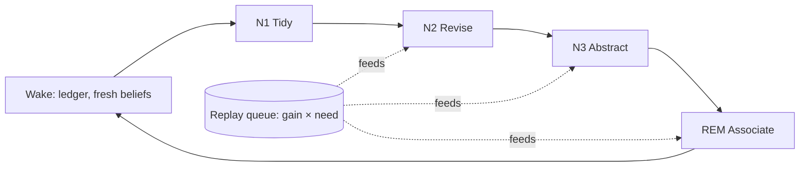

# 07 · Consolidation and evolution

> **What this document decides:** how beliefs are revised when new evidence arrives, how confidence is computed, how Orbit avoids believing its own output, what runs offline, what "forgetting" means, and how the identity model evolves.

## 1. Revision: Scope-Before-Supersede

A new claim that conflicts with an existing belief can mean four different things. Treating them alike is the commonest way memory systems corrupt themselves.

| What happened | Example | Correct response |
|---|---|---|
| **Contextual variation** | "I prefer Rust for systems programming" (after "I prefer Python") | Both hold, in different scopes |
| **Change** | "I've moved the engine to Go" | Old belief was true and stops being so: close its *valid* time |
| **Correction** | "I was wrong, the limit is 200" | Old belief was never right: close its *system* time |
| **Noise** | An assistant's guess; a mis-extraction; a web page | Record it; change nothing |

The revision function tries them in that order — scope first, then time, then authority — and refuses to guess when none applies.

```python
def step(state, c):                       # state: versions in one slot family; c: a verified claim that is not an echo
    if c.act == "correct":
        t = target_of(c, state)                          # by explicit id, by slot, or by what was just served (§7)
        state.retract(t, reason=c)                       # system time closes
        return state.assert_(c, valid_from=t.valid.lower if c.retroactive else c.asserted_at)

    for b in state.related(c):                           # closest first
        rel = relation(c, b)                             # same | refines | contradicts | unrelated   (cached judgment)
        if rel == "same":     return state.reinforce(b, c)
        if rel == "refines":  return state.new_version(b, c, link="refines")
        if rel == "contradicts":
            # 1 — scope: can both be true?
            if narrower(c.scope, b.scope):  return state.assert_(c, link=("specializes", b))   # an exception to a default
            if narrower(b.scope, c.scope):  return state.assert_(c, link=("generalizes", b))   # a new default; b remains the exception
            if disjoint(c.scope, b.scope):  return state.assert_(c)
            # 2 — time: did it change?
            if fluent(c.predicate) and authority(c) >= authority(b):
                state.close_valid(b, at=c.valid_from)                                          # superseded
                return state.assert_(c, link=("supersedes", b))
            # 3 — authority: is one side simply more credible?
            if authority(c) > authority(b): state.retract(b, reason=c); return state.assert_(c)
            if authority(c) < authority(b): return state.attach_attack(b, c)                   # b stands; c is on record
            # 4 — cannot tell
            return state.dispute(b, c)                                                         # both kept; ask the user
    return state.assert_(c)
```

- `relation` is deterministic when both sides are structured (same slot, `functional` predicate, different value ⇒ contradiction) and otherwise a model judgement over the two statements **and their evidence**. Judgements are stored with the model and prompt version that made them, so they can be audited and redone.
- `authority(c)` is the tuple *(integrity, explicitness, act strength)*. A typed, explicit user statement outranks anything relayed, inferred or reported. Recency is deliberately not part of authority; it is handled by step 2 and only for predicates that can change.
- Step 4 is a feature. A disputed belief is served as disputed, with both sides and their sources.

**Status:** bi-temporal invalidation is *Proven* (Graphiti). Trying scope before supersession, separating correction from change, and gating by channel integrity are ours (*Hypothesis*), tested by the update, correction and scoped-preference suites against a last-write-wins baseline.

## 2. Slot replay: order does not matter

Beliefs are grouped into **slots** — one per `(subject, predicate, scope)` for functional predicates, one per `(subject, predicate, object, scope)` otherwise. Revision is never applied incrementally to whatever happens to be current. Instead, when a claim arrives, every slot it touches is recomputed:

```python
def recompute(slot):
    claims = sorted(claims_touching(slot) - retracted - echoes, key=lambda c: (c.asserted_at, c.id))
    state  = fold(step, claims, initial=EMPTY)           # pure; model judgements come from the cache
    apply_diff(state, stored_versions(slot))             # closes and opens versions at system time = now
```

Because the result is a function of the *set* of claims in event-time order, it is the same whether evidence arrived in order, out of order, or all at once in an import — and the same on every replica. That gives the convergence properties of a CRDT without CRDT machinery (INV-9). Slots are small (typically a handful of claims), so recomputation is cheap.

## 3. Justification and confidence

Every belief keeps the claims that support, attack, explain or ratify it. This is a justification-based truth maintenance system in the classical sense (Doyle, 1979): a belief is *in* while at least one justification holds, and changes propagate.

- Evidence is deleted → its claims are retracted → beliefs with no remaining support are retracted → views that cite them are marked dirty. Erasure is therefore **correct by construction** (INV-8), not a best-effort sweep.
- An extractor version is rolled back → its claims are withdrawn → the same propagation runs.

**Confidence is computed from that structure, never reported by a model:**

$$ \text{conf}(b) = \Big[\,1 - \prod_{g \in G^+} (1 - w_g)\Big] \cdot \prod_{g \in G^-} (1 - a_g) $$

`G⁺` are *independent* groups of supporting claims — one per episode-day, so saying something five times in one conversation counts once (the spacing effect, used as an anti-gaming rule). `w_g` is channel integrity × extraction confidence × explicitness for the best claim in the group; `G⁻` are attacking groups. The raw value is then calibrated against labelled outcomes so that "0.9" means right nine times in ten.

`standing` follows: `confirmed` on explicit user confirmation or ≥ 2 independent `user_direct` groups; `disputed` while an unresolved attack of comparable authority exists.

## 4. Echo Guard

Orbit serves a belief to Claude; Claude repeats it in the conversation; the conversation is ingested; the extractor finds a fresh "statement". Left alone, an inference would corroborate itself into a fact. People make the same mistake — it is a source-monitoring failure — and so do wikis and model-training pipelines.

Orbit knows exactly what it served, to which session, and when (the disclosure log). At verification:

- an assistant-authored claim matching something served in that session is marked `echo_of` and excluded from support;
- a user-authored claim that merely *repeats* served content ("as you said, I prefer X") also counts as an echo unless it adds commitment of its own — an explicit confirmation is a `ratify`, which does count;
- writes through MCP tools from the client that was served are checked the same way.

**Status:** ours (*Hypothesis*); tested by a suite that feeds served inferences back through conversations and requires that basis never rises.

## 5. Sleep cycles

Understanding happens offline, in four passes of increasing cost. They run per user, when that user is idle, and nightly.



| Cycle | When | Does | Model use |
|---|---|---|---|
| **N1 Tidy** | Minutes after activity stops | Close episodes; settle provisional entity links (blocking → pairwise scoring → clustering under user `same_as` / `different_from` constraints); merge duplicate claims; add contiguity edges | Small |
| **N2 Revise** | After N1 | Recompute queued slots; look for cross-slot conflicts among graph neighbours; recalibrate confidence and standing; expire transient states; queue questions | Small–medium |
| **N3 Abstract** | Nightly | Regenerate dirty views (briefs, profiles, topic and period summaries); induce procedures and identity regularities; write gist nodes for cold episodes | Stronger; batch pricing |
| **REM Associate** | Nightly, budgeted | Propose and verify non-obvious links across projects and time | Stronger; batch pricing |

**Association discovery (REM)** is how Orbit connects things the user never linked. Candidate pairs come from: embedding neighbours with no short graph path between them; bridges through rare entities; structural analogy (the same pattern — say, *rejected for operational complexity* — in two projects); and co-use statistics. A model must state the relation in one cited sentence; accepted links become `associated` edges with basis `inferred`. They influence ranking in associative queries and are never presented as facts.

**Abstraction (N3)** writes views under two constraints: handle-locked text ([06 §5](06-memory-formation.md#5-exactness-anchors-and-handles)) and a citation on every sentence. Most brief sections are assembled from typed beliefs by template; the model is used only to compress prose.

## 6. What gets replayed first

Consolidation budget is finite, so the queue is ordered by

$$ \text{priority}(x) = \underbrace{\big(\text{surprise}(x) + \text{dirty dependents}(x) + \text{failed recalls touching } x\big)}_{\text{gain}} \times \underbrace{\big(e^{B(x)} + \text{active project}(x)\big)}_{\text{need}} $$

following the gain × need account of hippocampal replay. Two consequences worth naming: **retrieval failures drive learning** — a query that came back *not found* or low-confidence queues the surrounding evidence for deeper extraction — and work on an active project is consolidated before last year's.

## 7. Reconsolidation

When a belief is served into a session, it is *labile* for that session. If the user then contradicts or corrects it, the correction is routed to that belief first — the target is known because the user is almost certainly responding to what was just shown. The update is still a new version; the difference from the brain is that the old one survives.

Clients can also do this explicitly with `orbit_correct(memory_id, …)`.

## 8. Forgetting is ranking

| Mechanism | Effect | Reversible |
|---|---|:-:|
| **Activation decay** — power law over real use events | Ranks lower | ✓ re-activates on use |
| **Tiering** hot → warm → cold | Leaves the in-memory index; still in Postgres and object storage; reachable by deep recall | ✓ |
| **Gist substitution** | A cold episode is represented in the hot index by its summary; verbatim on request | ✓ |
| **Suppression** of superseded versions | Hidden from "current" queries, visible to history queries | by query |
| **Expiry** of transient states | Marked `expired`; kept as history | ✓ |
| **Span-preserving retention** | After a user-set period, raw content is dropped except the anchored spans that justify surviving beliefs | ✗ |
| **User deletion** | Evidence erased; dependents retracted; indexes purged | ✗ |

An **importance floor** stops decay from burying things that are rarely needed and critical when they are (an allergy, a legal constraint, a hard-won root cause): activation ranks comparable items against each other; it is never a filter on truth.

## 9. Identity: stable traits, passing states

Identity beliefs are ordinary beliefs about the user, with one addition: a **stability** estimate that separates *who the user is* from *how they are today*.

| Signal | Computed from |
|---|---|
| Consistency | Share of time-decayed observations that agree |
| Temporal spread | The span over which supporting observations occur |
| Context spread | Distinct projects, clients and activities they come from |
| Basis mix | Self-statement vs observed behaviour |

| Class | Meaning | Default treatment |
|---|---|---|
| `state` | Transient (mood, today's focus) | Expires in days; never in the identity card |
| `phase` | Holds for weeks to months | Served with its date range |
| `trait` | Stable | Requires ≥ 3 independent occasions across ≥ 2 contexts over ≥ ~2–3 months with no recent contradiction (initial thresholds; to be tuned) |

A change-point detector over each slot's observations distinguishes a real shift from noise; on a shift the old regime is closed in valid time and the new one starts as a `phase`. Because identity beliefs are scoped, most apparent contradictions ("concise in code review, expansive in strategy") turn out to be contextual and are kept as such — a trait as a distribution over situations.

Rules specific to identity:

- A self-statement is `stated` immediately; it still has to earn `trait`.
- Behavioural generalisations ("tends to choose the simpler design") are `inferred`, shown in the review queue, and not served as fact until confirmed.
- **Sensitive categories are never inferred** — health, politics, religion, sexuality and the like are stored only if the user states them, and only then with the `sensitive` label.
- The user can pin, edit or veto anything; edits in Orbit's UI are `user_direct` evidence like any other.

The compiled **identity card** has three tiers: *core* (confirmed traits, values and communication style, ~150 tokens, stable enough to cache), *contextual* (by project or activity), and *tentative* (never served by default).

## 10. Procedures

Procedural memory is induced from repeated behaviour — commands the user typed, files the user committed, conventions the user stated — and **only** from `user_direct` or `user_artifact` evidence. A suggestion from an assistant that the user did not adopt is not behaviour. A candidate needs ≥ 3 supporting episodes on ≥ 2 distinct days, is stored `inferred` with its supports, and becomes servable as a rule only after confirmation. The bar is high on purpose: a procedure is an instruction to every future agent.

## 11. Asking the user

Some questions only the owner can settle: disputed beliefs, high-impact inferences, uncertain entity merges, corrections submitted by low-trust clients. They go to a **review queue**, ordered by impact × uncertainty and capped by a weekly interruption budget. Items can be answered in Orbit's UI, or opportunistically inside a live session through an MCP elicitation when the topic is already under discussion and the client supports it. Unanswered items simply keep their conservative status.

## 12. Two worked examples

**Preference evolves.**

| When | Evidence | Result |
|---|---|---|
| May | "I prefer Python." | `bl₁`: Python, scope general, `stated`, valid May → |
| Nov | "I prefer Rust for systems programming." | Contradiction; Rust's scope is narrower → `bl₂` *specializes* `bl₁`. Both current |
| Later | "Honestly I reach for Rust everywhere now." | Same scope as `bl₁`, fluent predicate, equal authority → `bl₁` valid until today (`superseded`); `bl₃`: Rust, general |
| Query | "What did I prefer originally, and how has it changed?" | `bl₁` → `bl₂` → `bl₃` with dates and quotes |

**Wrong, then corrected through another client.**

| When | Evidence | Result |
|---|---|---|
| Day 1, Claude | "The API limit is 100 requests a minute." | `bl₁`: limit = ⟦100⟧, `stated` |
| Day 3, Codex | "I told you 100 before — that was wrong, it's 200." | `correct` → `bl₁` `retracted` (system time closes, reason linked); `bl₂`: limit = ⟦200⟧, valid from `bl₁`'s start |
| Query, any client | "What's the limit?" | 200 — on request: "corrected on day 3 via Codex; an earlier statement of 100 was retracted" |
| Audit | "What did Orbit believe on day 2?" | 100 |

## 13. Decisions

| Decision | Alternatives | Why this | Cost | Test |
|---|---|---|---|---|
| Scope → time → authority → dispute | Last-write-wins; LLM picks ADD/UPDATE/DELETE | Distinguishes the four cases; never silently destroys | Scope inference errors create spurious exceptions | Update / correction / scope suites vs LWW |
| Slot replay | Incremental mutation | Order independence; identical on replicas; redo with new judgements | Recompute cost (small slots) | Shuffle-ingestion invariant |
| Computed, calibrated confidence | Model self-report | Auditable; resistant to repetition | Needs labels | Calibration error |
| Echo Guard | None (state of practice) | Prevents self-corroboration | May discount a genuine re-statement | Echo suite |
| Offline consolidation in four passes | All at write time; none | Quality without write latency; cost control by priority | Staleness of views (minutes to a day) | With/without views ablation |
| Forgetting as accessibility | Deleting by decay | Selective and complete at once | Storage grows | Cold-recall tests |
| Conservative identity and procedure promotion | Promote on first signal | A wrong trait or rule misleads every future agent | Slower to "know" the user | Review acceptance rate; epistemic-violation invariant |
