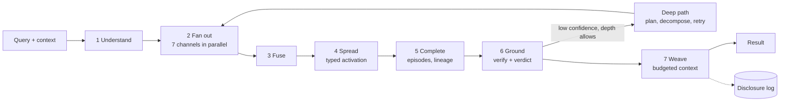

# 08 · Retrieval: Resonance Recall

> **What this document decides:** how Orbit finds the right memories (Challenge B in the brief), how it verifies them, how it knows when it has nothing, and how it turns them into a context an AI can use. The pipeline is called **Resonance Recall**: cues from the query excite several indexes at once, activation spreads through the memory graph, and what resonates is checked against evidence before anything is returned.

## 1. Contract

Recall returns **memories with their status**, not an answer. Composing the answer is the calling model's job; guaranteeing that what it is given is real, current and attributable is Orbit's.

Every result carries one of four verdicts, in the structured output where the caller cannot miss it:

| Verdict | Meaning |
|---|---|
| `grounded` | Memories found; each cites evidence the caller is allowed to see |
| `partial` | Some of what was asked is known; the gaps are listed |
| `conflicting` | Evidence disagrees; both sides are returned with their sources |
| `not_found` | Nothing sufficient. Related memories may be attached, explicitly marked *not an answer* |

## 2. Pipeline



```python
def recall(req, grant):
    plan  = understand(req)                       # cues, intent, time, scope — no LLM on the fast path
    mask  = policy_mask(grant, plan.scope)        # compartments, kinds, sensitivity ceiling, integrity floor
    cands = fan_out(plan, mask)                   # slot · literal · lexical · dense · entity · temporal · working memory
    seeds = fuse(cands, plan.intent)
    act   = spread(seeds, plan, mask) if plan.intent.spreads else seeds
    items = complete(top(act), plan)              # belief → claims → anchors → episode; lineage when asked
    items = ground(items, plan)                   # validity, support, lure check, byte check
    verdict = metamemory(items, plan)             # calibrated: grounded | partial | conflicting | not_found
    if verdict.weak and req.depth != "fast":
        return recall_deep(req, grant, plan, items)
    ctx = weave(items, plan, req.budget_tokens)
    log_disclosure(req, grant, ctx)               # audit; Echo Guard; reconsolidation window
    return Result(verdict, ctx)
```

The mask is applied **before** ranking, so data a client may not see cannot even influence the order of what it does see (INV-7).

## 3. Understanding the query

The fast path uses no generative model: grammar-based literal and time parsers, an alias dictionary for entity linking, a small intent classifier, and one embedding call.

**Cues extracted:** literals (quoted strings, identifiers, paths, versions) · entities · time expressions ("last September"; "before I switched to Rust", which is resolved through the belief it refers to) · memory kinds · scope, from the project binding, the client's grant profile and working memory.

**Intent decides the shape of the search and of the answer.**

| Intent | Example | Leading channels | Spreading | Returns |
|---|---|---|---|---|
| `exact` | "the exact command I used" | Literal, lexical | None | Verbatim anchors |
| `fact` | "which database did I want for Orbit?" | Slot, entity, dense | Light | Belief + evidence |
| `episode` | "what did I discuss with Claude last September?" | Temporal, entity, lexical | Along `part_of` / `next` | Episode cards |
| `evolution` | "my original plan, and how it changed" | Slot → lineage | `supersedes` / `refines` chain | Timeline |
| `rationale` | "why did I reject that architecture?" | Slot (decisions), dense | `rationale_for` / `alternative_to` | Decision record |
| `associative` | a new idea; "what does this connect to?" | Dense, entity | Wide, including `associated` | Related memories, grouped by why |
| `project` | an agent starting work | Views, scoped slot | Within the project | Brief + task pack ([09](09-project-memory.md)) |
| `identity` | "how do I like PRs structured?" | Slot (identity, procedural) | None | Rules with their basis |
| `aggregate` | "what were the themes of my year?" | Period and topic views | Hierarchical | Summary with drill-down |
| `prospective` | "what did I say I'd do?" | Intentions | None | Open intentions |

The current context is itself a cue. What the user is working on right now (working memory) contributes weak seeds, which is encoding specificity put to work: memories formed in a similar context come back more easily.

## 4. Channels

| Channel | Index | Finds | Engine time |
|---|---|---|---|
| **Slot** | B-tree on subject / predicate family / scope + validity range | Current or as-of beliefs, by structure | < 5 ms |
| **Literal** | Exact, normalised and trigram keys | Exact strings | < 5 ms |
| **Lexical** | BM25 over evidence (with context prefix), claim and belief statements, summaries; code-aware tokenisation | Rare terms, names, phrases | 5–20 ms |
| **Dense** | ANN over statements, summaries and chunks; several query vectors | Paraphrase, concepts, different vocabulary | 5–20 ms |
| **Entity** | Alias dictionary → entity → attached nodes | Everything about X | < 5 ms |
| **Temporal** | Interval index over episodes and validity | "Last September"; first / last / original | < 5 ms |
| **Working memory** | The workspace | What is active now | < 1 ms |

The slot channel is the one most systems lack and the reason indirect questions work: "that database technology I wanted for Orbit" becomes *beliefs in scope Orbit, of kind stack / decision / preference, whose object is a technology in category database* — a structured lookup, not a hope that an embedding lands near the right sentence.

**Fusion.** Weighted reciprocal-rank fusion with per-intent channel weights to start with: it needs no score calibration and is hard to break. A learned, calibrated combiner replaces it once there are logged outcomes to train on.

## 5. Typed Spreading Activation

Fusion gives *seeds*: the memories that match directly. Spreading finds what is *connected* to them — the rationale behind a decision, the earlier version of a plan, the conversation in another tool about the same idea.

### 5.1 Model

Let `s` be the normalised seed vector. Activation flows over the per-user graph ([05 §8](05-memory-model.md#8-knowledge-graph)) as a personalised random walk whose transition weights depend on the **query intent**:

$$ P_\theta(u \to v) = \frac{\theta_{\text{intent},\,\text{type}(e)} \cdot w_e \cdot \text{trust}(v)}{Z_u} \qquad \pi = \rho\, s + (1-\rho)\, P_\theta^{\top} \pi $$

over edges that are valid at the query's reference time and permitted by the mask. The final score of a node combines graph resonance, a usage prior and direct match:

$$ A_i = \lambda_1 \log(\pi_i + \delta) + \lambda_2 B_i + \lambda_3 m_i \qquad B_i = \ln \sum_k \omega_k\,(t - t_k)^{-d} $$

`B` is ACT-R's base-level activation over the node's real **use events** — created, restated by the user, used in an answer, confirmed — with `d = 0.5` and weights `ω` by event kind (merely being retrieved counts for little). It is maintained in constant space with the standard hybrid approximation (a few recent timestamps plus a count).

What each term buys:

| Term | Effect |
|---|---|
| Normalisation by `Z_u` | The **fan effect**: a hub such as "Orbit" spreads thinly over its thousand neighbours; a rare entity passes almost all of its activation on. This is IDF, for free, on a graph |
| `θ` by intent and edge type | The same graph answers different questions: a *rationale* query pulls along `rationale_for`; an *evolution* query along `supersedes` |
| Validity at reference time | "As of March" walks the graph as it was in March |
| `trust(v)` | Low-integrity nodes conduct less |
| Mask inside the walk | Unseen data has no influence (INV-7) |
| `B` | Recently and often *used* memories surface first, with an importance floor so rare, critical ones are not buried |

The user's own node, and any node above a degree threshold, is not traversed.

### 5.2 Algorithm

Activation is computed with a local "push" method, which touches a number of edges that depends on the precision asked for and not on the size of the graph.

```python
def spread(seeds, plan, mask, rho, eps):
    p, r  = defaultdict(float), defaultdict(float, normalise(seeds))
    queue = deque(r)
    while queue:
        u = queue.popleft()
        if r[u] < eps * out_weight(u): continue
        p[u] += rho * r[u]                              # keep
        flow, r[u] = (1 - rho) * r[u], 0.0              # pass on
        edges = [e for e in out_edges(u)
                 if mask.allows(e.dst) and e.valid_at(plan.as_of) and e.dst not in STOP_NODES]
        Z = sum(THETA[plan.intent][e.type] * e.weight * trust(e.dst) for e in edges)
        if Z == 0: p[u] += flow; continue               # nowhere permitted to go: the activation stays here
        for e in edges:
            r[e.dst] += flow * THETA[plan.intent][e.type] * e.weight * trust(e.dst) / Z
            queue.append(e.dst)
    return p        # then: A = λ1·log(p+δ) + λ2·B + λ3·match; lateral inhibition within a slot family
```

Work is bounded by `O(1 / (eps · rho))` pushes. On a graph held in memory this is a few milliseconds.

**Lateral inhibition.** Versions of the same slot compete: the one applicable to the query's context and time keeps its activation and the others are demoted — unless the intent is `evolution`, where the whole chain is wanted.

### 5.3 Initial weights

Hand-set starting values; they are to be learned from logged outcomes.

| Edge type | fact | episode | evolution | rationale | associative | project |
|---|:-:|:-:|:-:|:-:|:-:|:-:|
| `about` | 1.0 | 0.6 | 0.6 | 0.6 | 1.0 | 1.0 |
| `supported_by`, `mentions` | 0.6 | 1.0 | 0.6 | 0.8 | 0.6 | 0.4 |
| `supersedes`, `refines`, `specializes` | 0.2 | 0.2 | 1.5 | 0.8 | 0.2 | 0.3 |
| `rationale_for`, `alternative_to` | 0.3 | 0.3 | 0.6 | 1.5 | 0.4 | 0.6 |
| `part_of`, `next` | 0.2 | 1.2 | 0.4 | 0.3 | 0.3 | 0.5 |
| `near_in_time` | 0.1 | 0.8 | 0.3 | 0.2 | 0.4 | 0.1 |
| `in_scope` | 0.5 | 0.4 | 0.4 | 0.5 | 0.3 | 1.5 |
| `associated` (inferred) | 0 | 0.1 | 0 | 0.1 | 1.0 | 0.1 |
| restart `ρ` | 0.6 | 0.5 | 0.5 | 0.5 | 0.3 | 0.5 |

## 6. Completion

A hit is a pointer; the answer is usually the thing it points into. For each top node Orbit completes the pattern:

- **belief →** its supporting claims → their anchored quotes → the episodes they came from; and its lineage when the intent is `evolution` or `rationale`;
- **episode →** an *episode card*: when, which client and model, which project, who took part, the summary, the decisions and claims made, key quotes, and the neighbouring episodes.

This is how "what did I discuss with Claude about the Orbit architecture last September?" returns a small set of reconstructed conversations in date order, and not sentences that happen to share words with the question.

## 7. The grounding gate

Nothing leaves without passing checks that are mostly deterministic.

| Check | Applies to | How |
|---|---|---|
| **Validity** | Beliefs | Valid and believed at the reference time |
| **Support** | Beliefs | Still justified; at least one anchor resolves and its hash matches |
| **Bytes** | Literals | The returned string equals the anchored span |
| **Lure** | Entity and literal answers | The cited evidence contains this name's surface form — not a confusable's |
| **Role** | "the command I *used*" | Occurrence role matches what was asked |
| **Applicability** | Scoped beliefs | The most specific belief for the query's context |
| **Relevance** (deep path) | Everything | A cross-encoder scores the query against the *evidence*, not the summary |

### Knowing what it doesn't know

A verdict is produced by a small calibrated model over features that are available for free:

> top score · margin to the runner-up · number of channels that independently found the item · share of the query's cues covered by its anchors · support count and basis · validity certainty · reranker score · literal match

Thresholds are set on evaluation data for a target false-memory rate. This is metamemory in the plain sense: a judgement about retrieval, made from the retrieval.

Three behaviours follow:

- **Exact intent never degrades to approximate.** If no anchored literal passes, the answer is `not_found` with what *is* known ("three deploy discussions; none contains a command").
- **Conflict is reported, not resolved.** Disputed beliefs are returned side by side.
- **Related ≠ answer.** Near misses can be attached, in a separate field with a different label.

## 8. The deep path

When the fast path is unsure, or the caller asks for depth, a planner model drives further rounds. Each round is ordinary fast recall; the planner produces *queries*, never answers, and sees only what the grant allows.

```python
def recall_deep(req, grant, plan, first):
    notes = Notes(first)                                  # what is established; what is missing
    for _ in range(MAX_ROUNDS):                           # default 3
        gaps = planner.gaps(req.query, notes)             # sub-questions, bridging entities, unresolved time references
        if not gaps: break
        for g in gaps:
            notes.add(recall(Request(g.query, mode=g.mode, depth="fast", as_of=g.as_of), grant))
        promote_cold_episodes(notes.promising)            # lazy extraction, on demand
    return ground_and_weave(notes, req)
```

Used for: decomposition of compound questions; multi-hop bridging (find B through A, then ask about B); hypothetical-answer expansion for dense search; event-anchored time ("after the migration" → find the migration, then search after it); and on-demand extraction of cold episodes that look promising.

A capable client can run this loop itself with the same tools; the server-side version exists for clients that make one call.

## 9. Weaving the context

The last step decides *what fits*. Given candidate items, each renderable at several resolutions, choose a set under a token budget that covers what was asked.

$$ \max_{S}\; \sum_{f \in \text{facets}} w_f \sqrt{\sum_{(i,r) \in S} \text{rel}(i,f)\, q(r)} \;+\; \lambda \sum_{(i,r) \in S} A_i\, q(r) \qquad \text{s.t.}\; \sum_{(i,r) \in S} \text{tokens}(i,r) \le \text{budget} $$

Facets are the query's cues or sub-questions (or, for a project brief, its required sections). The square root makes coverage concave: a second item on an already-covered facet is worth less than the first item on an uncovered one, which yields diversity without a separate redundancy term. The objective is monotone submodular, so a greedy choice by marginal gain per token has a constant-factor guarantee.

**Resolution per item.** Each memory can be rendered as a one-line gist, its statement, its statement with a quote, or a full excerpt. The weaver spends tokens where relevance is highest — quotes for what matters, gist for the periphery — and attaches an id to everything so the caller can expand on demand. Gist and verbatim are both always available; the choice is made at retrieval time.

**Order.** Stable material first (identity card, project brief — versioned, rarely changing, so the caller's prompt cache stays warm), then task-specific memories, the most important at the start and end. Timelines are chronological; conflicts sit together.

**Framing.** Recalled content is delivered as *data* with provenance — `[stated · 2026-03-02 · Claude Desktop · bl_55…]` — never as instructions. Anything from low-integrity sources is excluded by default; when requested it is quoted, labelled `untrusted`, and has instruction-like spans withheld ([11](11-security-privacy.md)).

## 10. Learning from use

Every recall is logged with its plan, candidates, what was served, and what happened next: used (the quote or literal reappears in the session), corrected, reformulated, ignored. That log:

- adds use events (so `B` reflects real usefulness, with reinforcement capped per period to avoid rich-get-richer loops);
- strengthens `associated` edges between memories that are repeatedly *used together*;
- supplies training data for the fusion combiner, the edge weights `θ` and the reranker;
- sends failures to the consolidation queue ([07 §6](07-consolidation.md#6-what-gets-replayed-first)).

## 11. The brief's six examples

| # | Query | What happens |
|---|---|---|
| 1 Indirect | "What was that database technology I wanted to use for the Orbit project?" | Cues: project *Orbit*, category *database technology*, modality *wanted*. Slot channel returns stack / decision / preference beliefs in that scope whose object is a database. Result: the choice, its status (preferred vs decided), rejected alternatives, quotes |
| 2 Cross-conversation | Claude and ChatGPT discussed related ideas; Codex asks | Both episodes mention the same entities and support beliefs in the same scope; `near_in_time` and (after consolidation) `associated` edges connect them. Codex receives the beliefs with provenance naming both sources |
| 3 Contextual | "What was the reason I rejected that earlier architecture?" | "That earlier architecture" resolves through the context handle and project scope to a `rejected_approach`; spreading along `rationale_for` and `alternative_to` brings the reasons and what was chosen instead |
| 4 Exact | "What was the exact command I used?" | Literal channel, kind `command`, role *typed by user*, filtered by context. Verbatim bytes with hash, or `not_found` |
| 5 Associative | The user mentions a new idea | Dense seeds; wide spreading with `associated` edges across projects; results grouped by *why* they relate, with inferred links marked |
| 6 Temporal | "What was my original plan, and how has it changed?" | Slot → lineage chain → timeline of versions with dates, reasons and quotes |

## 12. Techniques and their role

| Technique | Strength | Weakness | In Orbit |
|---|---|---|---|
| Dense vectors | Paraphrase, concepts | Blind to exact strings and rare names; no notion of time or truth | One channel |
| Sparse / BM25 / full text | Names, identifiers, phrases | Misses paraphrase | One channel; primary for evidence |
| Literal / identifier match | Exactness | Nothing else | Dedicated channel; the only path for `exact` |
| Structured (slot) lookup | Precise for state questions | Needs extracted structure | Dedicated channel |
| Entity-based | "Everything about X" | Needs resolution | Channel + graph seeds |
| Temporal | Time-bounded and as-of questions | Needs resolved dates | Filter, boost, and graph validity |
| Graph traversal / PPR | Multi-hop association | Drifts without constraints | Typed, masked, bounded spreading |
| Hierarchical (summary trees) | Broad questions | Lossy if used alone | L3 views for `aggregate`; drill down to evidence |
| Contextual retrieval (context prefix per chunk) | Better recall on isolated chunks | Indexing cost | Applied to evidence chunks |
| Query expansion, hypothetical answers | Vocabulary mismatch | Can drift | Deep path only |
| Decomposition, recursive and agent-driven retrieval | Compound and multi-hop questions | Latency, cost | Deep path; or the client drives it |
| Reranking (cross-encoder) | Precision at the top | Latency | Deep path; relevance check on evidence |
| Activation / relevance scoring | Recency, frequency, context | Popularity bias | Base-level prior with floor and caps |
| Hybrid fusion | Robustness | Needs weights | Always |

## 13. What is new here

Stated plainly, so nothing is oversold.

| Mechanism | Closest prior art | What Orbit adds | Status |
|---|---|---|---|
| Spreading activation for agent memory | HippoRAG / HippoRAG 2 (Personalised PageRank); SYNAPSE (activation, inhibition, decay) | Intent-conditioned weights per edge type; bitemporal validity in the walk; policy and integrity masks in the walk; base-level from logged *use*; bounded local computation | Hypothesis |
| Slot channel | Structured stores (Mem0 records, Graphiti edges) | Scope-aware, as-of lookup as a first-class retrieval channel fused with the rest | Adapted |
| Grounding gate with verdicts | Agent Zero's citation lock; attributed QA | Deterministic byte, lure and role checks; a calibrated verdict from retrieval features; `conflicting` as a first-class outcome | Hypothesis |
| Budgeted, multi-resolution weaving | Submodular summarisation; MMR | Choosing resolution per item under one objective; cache-stable ordering | Hypothesis |
| Non-interfering retrieval | Access filtering after retrieval | Masking before ranking and inside the graph walk | Adapted (from information-flow control) |

## 14. Budgets (targets, to be measured)

| Path | Engine time, p95 | Model calls |
|---|---|---|
| Fast | ≤ 150 ms | One embedding |
| Deep | ≤ 3 s | 2–4 |
| `exact` | ≤ 50 ms | None |
| Context for a known project | ≤ 100 ms (views are precomputed) | None |

## 15. Decisions

| Decision | Alternatives | Why this | Cost | Test |
|---|---|---|---|---|
| Return memories and a verdict, not an answer | Server-side answer generation | Keeps the brain model-independent; lets the caller reason; makes abstention explicit | Callers must handle verdicts | Hallucination rate with and without verdicts |
| No LLM on the fast path | LLM query rewriting on every call | Latency, cost, independence | Harder queries need the deep path | Fast-path accuracy by intent |
| Several channels + fusion | Dense only; graph only | Each fails differently | More indexes | Per-channel ablation |
| Typed spreading | Untyped PPR; no graph | Different questions need different association | Weights to tune | Ablation on multi-hop / rationale / evolution |
| Verdict from a calibrated model | Score threshold; LLM self-check | Cheap, tunable to a false-memory target | Needs labelled data | Abstention precision / recall |
| Mask before ranking | Filter after | Non-interference | Cache per policy | Non-interference invariant |
