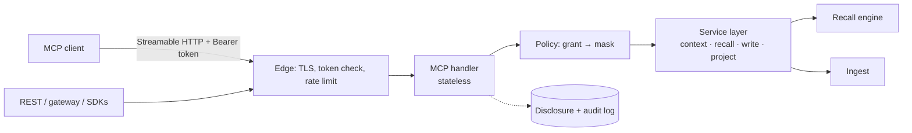

# 10 · Interoperability: MCP server, APIs, gateway

> **What this document decides:** how any AI reaches the brain. MCP is the primary interface, written against the **2026-07-28** revision of the specification. It is not sufficient alone, and this page says what else is needed and why.

## 1. Is MCP enough?

No. MCP tools are *model-controlled*: recall happens if the model calls a tool, and capture happens if the model decides to write. A memory that depends on the diligence of whichever model is connected is not reliable. Orbit therefore has one service layer and several surfaces over it.

| Surface | For | Why it exists |
|---|---|---|
| **MCP server** | Claude, Codex, ChatGPT, IDE agents, any MCP client | The standard way an AI discovers and calls tools; primary read/write path for agents |
| **REST API** | Orbit's own apps, connectors, bulk import/export, the review UI | Canonical API. MCP tools are a façade over the same handlers |
| **Event feed + webhooks** | Device sync; third-party apps | Push instead of poll |
| **Capture connectors** | Agent hooks, transcript importers, browser extension | Deterministic capture, outside the model's discretion ([06 §1](06-memory-formation.md#1-capture)) |
| **LLM gateway** | Clients with no MCP support; local models; scripts | Capture and context injection for anything that lets you set a base URL |
| **SDKs** | TypeScript, Python, Rust, Kotlin | Typed clients with an offline outbox |

A dedicated agent-to-agent protocol is **not** needed for the memory phase. It becomes relevant when Orbit acts as an agent among agents and should be evaluated then.

## 2. MCP server architecture

### 2.1 What the 2026-07-28 revision changes

| Change in the specification | Consequence for Orbit |
|---|---|
| Protocol sessions and the `initialize` handshake are removed; each request carries protocol version, client info and capabilities in `_meta` | The server is stateless and horizontally scalable; no sticky routing |
| Servers **must** implement `server/discover` | Advertise versions, capabilities, identity |
| State across calls uses explicit, server-minted **handles** passed as ordinary tool arguments | Orbit's "attention session" is a `context_handle` ([§4](#4-handles-and-state)) |
| **Roots, Sampling and Logging are deprecated** | Project identity comes from tool arguments ([09 §4](09-project-memory.md#4-identifying-the-active-project)); Orbit runs its own model gateway and never borrows the client's model; telemetry is OpenTelemetry |
| Server-initiated requests are replaced by **multi round-trip requests**: a tool returns `input_required`; the client retries with the answers and an opaque `requestState` | Used for user confirmation of sensitive writes |
| `tools/list` must not vary per connection but **may vary by the authorization presented**; tools **should** be returned in a deterministic order | Tool list filtered by granted scopes; stable order keeps client prompt caches warm |
| List results carry `ttlMs` and `cacheScope` | `cacheScope: "private"` (the list depends on the token) |
| Change notifications move to `subscriptions/listen` | Resource updates for briefs |
| Tasks move to an extension | Not needed: recall is fast; bulk work goes through REST |
| Client ID Metadata Documents preferred; Dynamic Client Registration deprecated; `iss` validation | See [§6](#6-authorization) |

Older clients will lag. An edge façade speaks earlier revisions (it answers `initialize` and issues a session id that carries no state) and maps onto the same handlers, for at least the specification's twelve-month deprecation window.

### 2.2 Shape



The MCP handler does three things: validate the token for *this* resource, turn the grant into a policy mask, and translate between MCP messages and service calls. All logic is below it, shared with REST.

## 3. Tool surface

Ten tools. A small surface matters: every tool description costs context in every session, and models choose worse among many similar tools.

| Tool | Purpose | Effect | Scope |
|---|---|---|---|
| `orbit_context` | **Start here.** Identity card, project brief or delta, working memory, task-relevant memories, due intentions; mints a `context_handle` | Read | `orbit:context` |
| `orbit_recall` | Associative recall; `mode` = `auto` · `fact` · `episode` · `rationale` · `associative` | Read | `orbit:recall` |
| `orbit_exact` | Verbatim commands, identifiers, quotes, values — byte-exact or nothing | Read | `orbit:exact` |
| `orbit_timeline` | How something evolved; or what happened in a period | Read | `orbit:recall` |
| `orbit_entity` | A person, project, technology: profile, relations, confusables | Read | `orbit:recall` |
| `orbit_expand` | Full detail or source evidence for an id | Read | `orbit:recall` (+ `orbit:exact` for verbatim) |
| `orbit_remember` | Contribute a memory, ideally with the user's own words | Additive write | `orbit:write` |
| `orbit_checkpoint` | Record where work stands: summary, decisions, next steps, artefacts | Additive write | `orbit:write` |
| `orbit_correct` | Correct, retract, confirm, mark outdated or re-scope a memory | Versioned write | `orbit:correct` |
| `orbit_project` | Resolve, bind, create or list projects | Read / write | `orbit:projects` |

Design rules: read tools carry `readOnlyHint`; writes are additive and idempotent (nothing an AI can call deletes anything); every tool has an `outputSchema` and returns `structuredContent` plus the same JSON as text, as the specification recommends; errors a model can fix are tool errors (`isError: true`) with a concrete instruction.

### 3.1 Key input schemas

```jsonc
// orbit_context
{
  "type": "object",
  "required": ["task"],
  "additionalProperties": false,
  "properties": {
    "task":    { "type": "string", "description": "What you are about to help with, in one or two sentences." },
    "project": { "type": "object", "additionalProperties": false, "properties": {
        "id":          { "type": "string" },
        "git_remote":  { "type": "string" },
        "root_commit": { "type": "string" },
        "name_hint":   { "type": "string" } } },
    "surface": { "enum": ["coding", "chat", "research", "planning", "other"] },
    "files":   { "type": "array", "items": { "type": "string" }, "maxItems": 20 },
    "budget_tokens": { "type": "integer", "minimum": 200, "maximum": 20000, "default": 2500 },
    "since":   { "type": "string", "description": "A context_handle or brief version from an earlier call. Returns only what changed." }
  }
}

// orbit_recall
{
  "type": "object",
  "required": ["query"],
  "additionalProperties": false,
  "properties": {
    "query":   { "type": "string" },
    "mode":    { "enum": ["auto", "fact", "episode", "rationale", "associative"], "default": "auto" },
    "project": { "type": "string" },
    "kinds":   { "type": "array", "items": { "type": "string" } },
    "time":    { "type": "object", "properties": { "from": { "type": "string" }, "to": { "type": "string" } } },
    "as_of":   { "type": "string", "description": "Answer as things stood at this time." },
    "depth":   { "enum": ["fast", "deep"], "default": "fast" },
    "include_superseded": { "type": "boolean", "default": false },
    "include_untrusted":  { "type": "boolean", "default": false },
    "budget_tokens":  { "type": "integer", "default": 1500 },
    "context_handle": { "type": "string" }
  }
}

// orbit_exact
{
  "type": "object",
  "required": ["what"],
  "additionalProperties": false,
  "properties": {
    "what":    { "type": "string", "description": "Describe the exact thing: 'the command I used to run the migration'." },
    "kind":    { "enum": ["command", "path", "url", "version", "identifier", "number", "date", "quote", "config", "term", "any"], "default": "any" },
    "role":    { "enum": ["typed_by_user", "suggested_by_assistant", "tool_output", "any"], "default": "any" },
    "project": { "type": "string" },
    "time":    { "type": "object" },
    "context_handle": { "type": "string" }
  }
}

// orbit_remember
{
  "type": "object",
  "required": ["content", "said_by"],
  "additionalProperties": false,
  "properties": {
    "content":    { "type": "string", "description": "One self-contained thing to remember." },
    "user_quote": { "type": "string", "description": "The user's own words, verbatim, if they said this." },
    "said_by":    { "enum": ["user", "assistant", "observed"] },
    "kind_hint":  { "type": "string" },
    "project":    { "type": "string" },
    "scope":      { "type": "object" },
    "when":       { "type": "string", "description": "If this is about another time than now." },
    "idempotency_key": { "type": "string" },
    "context_handle":  { "type": "string" }
  }
}

// orbit_correct
{
  "type": "object",
  "required": ["memory_id", "action"],
  "additionalProperties": false,
  "properties": {
    "memory_id":   { "type": "string" },
    "action":      { "enum": ["correct", "retract", "outdated", "confirm", "rescope"] },
    "replacement": { "type": "string" },
    "user_quote":  { "type": "string" },
    "reason":      { "type": "string" }
  }
}
```

### 3.2 Output: one memory item

```jsonc
{
  "id": "bl_01JC8Z…",
  "kind": "project.decision",
  "text": "No graph database as system of record; edges live in PostgreSQL and are projected into memory.",
  "basis": "stated",            // stated | observed | reported | inferred | assumed
  "standing": "confirmed",      // confirmed | unconfirmed | disputed
  "lifecycle": "current",       // current | superseded | retracted | expired
  "valid": { "from": "2026-03-09", "to": null },
  "scope": { "project": "orbit" },
  "confidence": 0.94,
  "integrity": "user_direct",
  "why": ["per-tenant isolation", "one source of truth"],
  "alternatives": [{ "id": "bl_01JC90…", "text": "Neo4j as the store", "status": "rejected" }],
  "sources": [{
    "evidence": "ev_01JC8Y…", "at": "2026-03-09T10:42:00Z", "via": "codex", "role": "user",
    "quote": "let's not run a graph database at all — keep edges in Postgres"
  }],
  "supersedes": null,
  "expand": "orbit://memory/bl_01JC8Z…"
}
```

`orbit_recall` returns `{ status, confidence, items[], gaps[], conflicts[], related[], usage }` where `status` is `grounded` · `partial` · `conflicting` · `not_found`. `orbit_exact` returns `{ status, matches[] }`, each match with `exact`, `sha256`, `kind`, `role`, `at`, `via`, and two lines of surrounding context, with the contract stated in the tool description: *`exact` is byte-for-byte what was recorded; reproduce it unchanged.*

### 3.3 Resources and prompts

- **Resources:** `orbit://identity/card`, `orbit://project/{id}/card`, `orbit://project/{id}/brief`, `orbit://memory/{id}`, `orbit://episode/{id}`. Clients that attach resources themselves can load a brief with no tool call; `subscriptions/listen` tells them when it changes.
- **Prompts:** `orbit/prime` (insert context for the current project) and `orbit/handoff` (write a checkpoint). These are user-invoked, for clients that surface prompts as commands.

## 4. Handles and state

`orbit_context` mints a `context_handle`: an opaque id naming an *attention session* — client, grant, project, what has been served so far. Later calls pass it back. It enables delta briefing, Echo Guard, the reconsolidation window, and resolution of "that earlier architecture".

Following the specification's guidance for stateful tools: a handle is **a name, not a capability** — authorization is checked on every call; it is opaque; its lifetime (24 h idle) is stated in the tool description; an expired handle returns a tool error telling the model to call `orbit_context` again. Every tool works without one.

## 5. Writes from AI clients

A write through MCP is a **claim by that client on someone's behalf**, not a fact.

| Sent | Stored as | Becomes |
|---|---|---|
| `said_by: "user"` + `user_quote` | Evidence at `user_relayed` | `reported`, or `stated` for kinds whose floor allows it; identity and procedural kinds wait for confirmation |
| `said_by: "assistant"` | Evidence at `agent` | `reported` / `assumed`; never identity or procedure |
| `said_by: "observed"` (the agent read it in a file or tool result) | Evidence at `agent`, with the pointer | `reported` until the artefact itself is ingested |

Further rules: writes are idempotent by key; a write containing a credential is **rejected** with an instruction not to store secrets; writes that echo what Orbit served are recognised and do not corroborate; per-client rate limits apply; and high-impact changes return `input_required` with an elicitation asking the user to confirm — when the client has declared elicitation support. Otherwise they are stored as *pending review* and the result says so.

`requestState` for those round trips is integrity-protected and binds the principal, an expiry and a digest of the original request, as the specification requires.

## 6. Authorization

Orbit's MCP endpoint is an OAuth 2.1 **resource server**; Orbit Auth is the authorization server.

| Requirement | Implementation |
|---|---|
| Protected Resource Metadata (RFC 9728) | Served at the well-known path; `401` responses carry `WWW-Authenticate: Bearer resource_metadata=…, scope=…` |
| Audience binding (RFC 8707) | Tokens are issued for the MCP resource URI and rejected otherwise; tokens for anything else are never accepted or forwarded |
| Client registration | Client ID Metadata Documents first; pre-registration for major clients; Dynamic Client Registration kept for compatibility |
| PKCE, short-lived access tokens, rotating refresh tokens, `iss` in authorization responses (RFC 9207) | Standard |
| Step-up | A call needing more returns `403` with `error="insufficient_scope"` and all scopes required, in one challenge |

**Scopes are coarse; grants are fine.** OAuth scopes gate which *tools* a client can call. What those tools can *see* is decided by a **grant** the user sets on the consent screen and can change later:

| Grant field | Example |
|---|---|
| Memory kinds | `project.*`, `procedural.*`, `identity.preference` |
| Compartments | Projects *Orbit* and *Atlas*; not `personal` |
| Sensitivity ceiling | `work` |
| Evidence access | `none` · `quotes` · `full` |
| Write | Allowed; integrity recorded as `user_relayed` / `agent` |
| Budgets | Tokens per day; calls per minute |
| Expiry | 90 days |

Profiles make this one click: **Coding agent** (projects, coding preferences, procedures; nothing personal), **General assistant** (identity and projects; personal up to a ceiling), **Read-only**, **Full**. The reasoning is contextual integrity: a fact is not simply private or public; it is appropriate to some contexts and not others.

## 7. REST API

| Method and path | Purpose |
|---|---|
| `POST /v1/ingest/events` | Append evidence (batched, idempotent) |
| `POST /v1/ingest/imports` | Bulk import: provider exports, agent logs, documents (asynchronous) |
| `POST /v1/context` | Same as `orbit_context` |
| `POST /v1/recall` · `POST /v1/recall/exact` · `GET /v1/timeline` | Retrieval |
| `GET /v1/memories/{id}` · `GET /v1/episodes/{id}` · `GET /v1/evidence/{id}` · `GET /v1/entities/{id}` | Inspect, down to the source |
| `POST /v1/memories` · `POST /v1/memories/{id}/corrections` · `POST /v1/checkpoints` | Writes |
| `GET/POST /v1/projects` · `POST /v1/projects/{id}/bindings` · `GET /v1/projects/{id}/brief?tier=&format=json\|md\|agents-md` | Project memory |
| `GET /v1/review` · `POST /v1/review/{id}` | The review queue |
| `GET/POST/DELETE /v1/grants` · `GET /v1/disclosures` | Who can see what; who saw what |
| `POST /v1/exports` · `DELETE /v1/evidence/{id}` · `DELETE /v1/account` | Ownership |
| `GET /v1/sync/changes?cursor=` · `WS /v1/sync` | Device sync |

**Events** (feed and webhooks): `belief.created` · `belief.superseded` · `belief.retracted` · `review.requested` · `project.brief.updated` · `intention.due`. Webhook payloads carry ids, not content; the receiver fetches what its grant allows.

## 8. LLM gateway

For clients that cannot speak MCP — many local-model front ends, scripts, some IDE integrations — Orbit offers provider-compatible endpoints (`/llm/openai/v1/chat/completions`, `/llm/openai/v1/responses`, `/llm/anthropic/v1/messages`) that forward to whatever model the user configured.

| Function | Header | Default |
|---|---|---|
| Capture the exchange as evidence | `X-Orbit-Capture: on \| off` | on |
| Prepend context (card, brief, or task-conditioned) | `X-Orbit-Inject: off \| card \| brief \| auto` | card |
| Name the project | `X-Orbit-Project` | resolved from history |

It is optional, and the trade-offs are real: it sits in the request path (latency, availability) and sees provider credentials. Keys are passed through and never stored unless the user opts in; the gateway can run locally beside a local model so that nothing leaves the machine except evidence bound for the brain.

## 9. Model and provider independence

| Dependency | How it is kept replaceable |
|---|---|
| Connected AI | Any MCP client; or REST; or the gateway. Tool results are plain structured data with no model-specific prompting |
| Extraction and consolidation models | Called through an internal gateway by *tier* (bulk, careful), not by name; every derived row records the model and prompt that produced it; re-derivable |
| Embedding model | An explicit *embedding space* id on every vector; two spaces can coexist during migration; a self-hostable open-weight model is the baseline so no external provider is required |
| Fast-path retrieval | No generative model at all |
| The client's model | Never used (Sampling is deprecated, and borrowing a client's model would make memory quality depend on who is connected) |

## 10. Decisions

| Decision | Alternatives | Why this | Cost | Test |
|---|---|---|---|---|
| MCP façade over a shared service layer | MCP-only server | First-party apps, connectors and bulk paths need more than tools | Two surfaces to keep in step | Contract tests run against both |
| Ten tools | One generic `memory` tool; dozens of specific ones | One tool hides intent from the model; dozens crowd context | Some overloading (`mode`) | Tool-selection accuracy with reference clients |
| Stateless server + explicit handle | Server-side sessions | Required by the current specification; scales trivially | Models must carry the handle | Works with and without a handle |
| Scopes for tools, grants for data | Scopes only | Scopes cannot express "these projects, below this sensitivity" | Consent UI to build | Grant leak-rate suite |
| AI writes are claims at reduced integrity | Trust the client | The write path is the poisoning path | Some true statements wait for confirmation | Poisoning suite |
| Own model gateway | MCP Sampling | Deprecated; and quality must not vary by client | Orbit pays for inference | — |
| Optional LLM gateway | Require MCP | Reaches clients MCP cannot | In the request path; key custody | Capture coverage |
