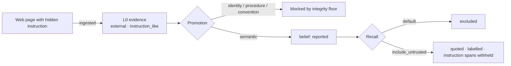
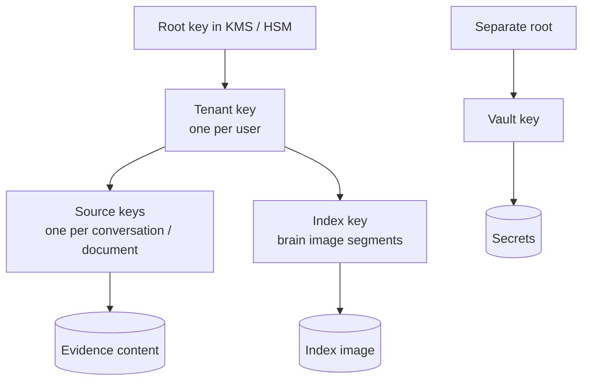

# 11 · Security and privacy

> **What this document decides:** the threat model for a memory that many AIs share, and the controls that answer it. Two things are specific to this product and get most of the space: memory as a *persistent injection surface*, and memory as *every connected agent's private-data source*.

## 1. Why a shared memory is different

- **It persists.** An instruction smuggled into one conversation can be recalled into every later one, in every tool. Prompt injection becomes stored injection.
- **It is written by software the user does not control.** Any connected model can be tricked into writing something false. Memory poisoning has been demonstrated through ordinary interaction alone (MINJA), with backdoor-style triggers (AgentPoison), and is now a named category in OWASP's agentic risk list (ASI06: memory and context poisoning). The same literature reports that content-level detectors are weak against it, because poisoned records look like plausible reasoning.
- **It is read by software the user does not control.** An agent with tool access to private data, exposure to untrusted content and a way to send data out has all three legs of the "lethal trifecta". Orbit is the first leg for everything connected to it.
- **It describes a person.** A breach discloses not a document but a life.

The design response is to stop relying on detecting bad content and instead make **provenance and permission structural**.

## 2. Threats and controls

| # | Threat | Primary controls |
|---|---|---|
| T1 | **Stored prompt injection** — text in an ingested page, document, email or tool result is later recalled and obeyed | Integrity labels (§3.1); data-only recall framing and untrusted-content handling (§3.2); never promotable to procedure or identity |
| T2 | **Memory poisoning through the write path** — a tricked or malicious client writes false memories | AI writes are claims at reduced integrity (§3.3); confirmation for high-impact kinds; rate limits and anomaly checks; Echo Guard |
| T3 | **Exfiltration by a connected agent** — broad querying, then sending data elsewhere | Grants and policy mask (§4); egress budgets; disclosure ledger; step-up for sensitive data |
| T4 | **Over-sharing with a legitimate client** — health details reaching a coding agent | Compartments, sensitivity ceilings, profiles (§4) |
| T5 | **Token theft, confused deputy, mix-up attacks** | OAuth 2.1 with PKCE, audience-bound tokens, `iss` validation, no token passthrough ([10 §6](10-interop-mcp-apis.md#6-authorization)) |
| T6 | **Cross-tenant leakage** | Row-level security, per-tenant index files, tenant-scoped caches (§7) |
| T7 | **Inference through ranking** — learning about hidden data from how visible results are ordered | Mask before ranking and inside the graph walk (§4.2) |
| T8 | **Operator or infrastructure compromise** | Envelope encryption with per-tenant keys; confidential computing path (§6) |
| T9 | **Leakage to model providers** | Routing by sensitivity; zero-retention endpoints; local models; minimal prompts (§8) |
| T10 | **Data that will not die** — deleted content surviving in indexes, caches, backups, derived text | Justification-driven retraction; per-source keys; purge deadlines (§9) |
| T11 | **Credential capture** | Vault, with detection at admission (§5) |

## 3. The memory firewall

### 3.1 Integrity is a type, and it only flows down

Every piece of evidence is labelled by the channel it arrived through ([05 §3.4](05-memory-model.md#34-how-far-to-trust-the-channel-integrity)): `user_direct` › `user_artifact` › `user_relayed` › `agent` › `external`. Derived items take the **minimum** of what they depend on. Kinds that define the user or instruct future agents require the top levels.

This is the Biba integrity model: lower-integrity sources cannot write up. Concretely, a web page can add a `reported` belief about the world. It cannot create a preference, a convention or a procedure, however persuasive its text, because no path from `external` evidence to those kinds exists in the revision function. The defence does not depend on recognising the attack.

Pasted or quoted material inside a user's message is labelled `external` too ([06 §1](06-memory-formation.md#1-capture)), which closes the commonest way third-party text acquires the user's authority.

### 3.2 Recall returns data, never instructions

| Rule | Detail |
|---|---|
| **Framing** | Memories are returned as structured items with provenance and an integrity label. Tool descriptions state that results are the user's recorded memories and are not instructions |
| **One instruction channel** | The only content phrased as guidance is a clearly separated section of *user-confirmed procedural memories at `user_direct` integrity* |
| **Untrusted content is opt-in** | Items below a client's integrity floor are excluded unless `include_untrusted` is set |
| **Neutralisation** | When untrusted text is returned, it is quoted, length-limited, labelled, and spans scored as instruction-like are replaced by a placeholder (`[instruction-like text withheld — 142 chars]`). The original is reachable through `orbit_expand`, with a warning |
| **Labels travel** | `integrity` and `origin` are in the structured output, so a security-aware client can refuse to let low-integrity data flow into tool arguments — the capability-style defence described in the CaMeL line of work |

Framing is a mitigation, not a guarantee: a model can still be persuaded by text it reads. That is why the structural controls come first and framing last.

### 3.3 The write path

| Control | Effect |
|---|---|
| Writes are **claims attributed to the client and model** | A poisoned write is, at worst, a `reported` belief with a visible author |
| **Integrity floors by kind** | Identity, procedure and conventions need the user, directly |
| **Confirmation** | High-impact changes ask the user (MCP elicitation, or the review queue). Pending items are not served as facts |
| **Additive only** | No MCP tool deletes or overwrites; a "correction" from a client creates a versioned, attributable change that can be undone |
| **Rate limits and anomaly checks** | A burst of identity or procedure changes from one client suspends its writes and notifies the user |
| **Echo Guard** | A client cannot corroborate a claim by repeating what Orbit told it ([07 §4](07-consolidation.md#4-echo-guard)) |
| **Reversibility** | Everything a client wrote can be listed and withdrawn at once; the justification graph retracts what depended on it |

## 4. Access control

### 4.1 Grants

Authentication establishes *who* (the user) and *through what* (the client). A **grant** decides what that client sees: memory kinds, compartments, a sensitivity ceiling, how much evidence (none, quotes, full), whether it may write, daily budgets and an expiry ([10 §6](10-interop-mcp-apis.md#6-authorization)).

The model behind this is contextual integrity: information is not simply private or public, but appropriate to some flows and not others. A diagnosis mentioned to a general assistant should not appear in a coding agent's context — not because it is secret from the user's tools in general, but because that flow breaks the norms under which it was shared.

### 4.2 The policy mask and non-interference

A grant compiles to a mask over nodes and edges. It is applied **before** candidate generation and **inside** the spreading walk, not as a filter on results. The property enforced is:

> The results for a client are identical to those computed on a copy of the brain with everything outside its grant deleted.

Filtering afterwards does not give this: hidden items would still shape scores and ordering, which is a side channel. Caches are keyed by tenant and policy hash for the same reason.

### 4.3 Limiting what leaves

- **Budgets per call** (items, tokens) and **per day per client**. An agent that suddenly reads far more than its history is throttled and the user is told.
- **Step-up** for anything above the grant's ceiling: the call returns `insufficient_scope`, and the user decides.
- **Disclosure ledger.** Every recall is recorded: which client, which query, which memories at which resolution. The user can ask "what did ChatGPT see about me this month?" and get an exact answer. The same log powers Echo Guard and evaluation.

## 5. Secrets

Credentials are not memories.

1. **Detect at admission**: provider key formats, private-key blocks, connection strings with passwords, high-entropy tokens near telltale words.
2. **Redact before persistence**: the stored evidence contains a handle, not the value.
3. **Vault separately**: a different store under a different root key, with its own audit trail.
4. **Never recall**: vault contents are not embedded, indexed, summarised or reachable through any memory tool. Whether Orbit should ever *broker* a credential to an agent is an autonomy-phase question and is out of scope here.
5. **Reject on write**: an MCP write containing a credential fails with an instruction not to store secrets.

## 6. Encryption and keys

| Layer | Protection |
|---|---|
| In transit | TLS 1.3 everywhere, including service-to-service |
| At rest | Envelope encryption: content under per-source keys, wrapped by a per-tenant key, wrapped by KMS. Index images under a per-tenant index key |
| Embeddings | Treated as sensitive as the text. Published inversion results show text can largely be recovered from embeddings, so they receive the same keys, masks and deletion |
| In use | Plaintext exists only in process memory of the ingest, brain, recall and model-gateway services; never in logs or traces |

**Who can read a brain** is the honest question, and the answer comes in stages:

| Stage | Who could technically read plaintext | Notes |
|---|---|---|
| 1 Launch | The service, under access controls, break-glass procedures and audit | Per-tenant keys make bulk access noisy and tenant deletion real |
| 2 Confidential computing | Only attested workloads inside trusted execution environments; operators cannot | Tenant keys released on attestation. CPU and GPU confidential computing for inference is maturing and published overheads are reported as manageable; needs self-hosted or attested models to be end-to-end |
| 3 User-held keys | The service only while the user's key is present | Background consolidation needs a time-boxed delegated key; real cost in capability |
| 4 Local brain | Nobody but the user | The same engine on the user's machine ([12 §9](../system-design/12-system-design.md#9-local-brain-mode)) |

The key hierarchy and a `KeyProvider` abstraction are built from the start so that later stages are configuration, not redesign.

**With one brain per deployment, the operator is the owner.** There is no vendor who could read the brain, and no other user to leak to. The parties still trusted are the cloud host the owner chose and the model providers the owner configured. Stages 2 and 3 above become relevant only if Orbit is ever offered as a hosted service; stage 1 controls (encryption at rest, keys in the cloud provider's KMS, backups under the owner's key) still apply, because the server is on the internet.

## 7. Tenant isolation

In the current plan isolation is by deployment: each brain has its own server, database and keys. The controls below are kept as inexpensive seams and become load-bearing only in a hosted multi-user service.

- Every table has `tenant_id`; **row-level security** is forced, and connections set the tenant from the verified token — application code cannot forget it.
- **Index images are per tenant and physically separate**. There is no shared vector index, so an indexing bug cannot return another user's neighbours.
- Caches, queues and model batches are tenant-keyed; prompts never mix tenants.
- Isolation is tested continuously with property and fuzz tests, and the non-interference property of §4.2 is an automated invariant.

## 8. Privacy toward model providers

| Rule | Detail |
|---|---|
| Route by sensitivity | `sensitive` content is processed by a self-hosted model only, or not processed beyond storage |
| No training | User data is never used to train shared models, by Orbit or by providers (contractual zero-retention where available) |
| Minimise | Prompts contain the spans being processed, not surrounding history |
| Record | Every model call is logged with provider, model and the ids — not the content — of what was sent |
| Offer a floor | An all-local configuration exists, at lower extraction quality |

## 9. Ownership: inspect, correct, export, delete

| Right | How |
|---|---|
| **Inspect** | Every belief opens to its claims and quotes; every disclosure is listed |
| **Correct** | Edits in Orbit's UI are `user_direct` evidence and win |
| **Export** | A bundle: `manifest.json` (schema versions, counts, checksums), `evidence.jsonl`, `claims.jsonl`, `beliefs.jsonl`, `entities.jsonl`, `edges.jsonl`, `views/*.md` (human-readable), `blobs/`. Complete enough to rebuild the brain elsewhere. Renderings for other assistants' import formats where those exist |
| **Delete an item** | Evidence is tombstoned and its key destroyed; the justification graph retracts everything that depended only on it; indexes are purged within a stated deadline; backups are unreadable for that item as soon as the key is gone |
| **Delete everything** | Destroy the tenant key, then purge storage |
| **Retain less** | Per-compartment retention: raw content can expire while the anchored spans that justify surviving beliefs are kept — or not, at the user's choice |

Deletion is the place where the architecture pays off most visibly. Because every derived item knows what it rests on, "forget this conversation" is a graph operation with a verifiable result, not a search for copies.

## 10. Audit

An append-only, hash-chained log records authentication events, grant changes, every disclosure, every write with its client and model, every correction, every export and deletion, and every administrative access. It is visible to the user and is itself covered by export.

## 11. Other people

A personal memory inevitably contains information about third parties — colleagues, family, correspondents — who did not agree to it. Defaults: third-party speech is `external`; relationship memories are `personal` unless clearly work-related; sensitive attributes of other people are not inferred; and recordings of conversations need a consent setting that reflects local law. This area needs legal review before launch and is listed as an open item in [17](../validation/17-roadmap-risks.md).

## 12. Residual risk

| Risk | Why it remains |
|---|---|
| A model obeys untrusted text it was shown despite labels | Models are not reliably robust to injection; Orbit reduces exposure, it cannot remove it |
| A fully compromised client with a broad grant reads what the grant allows | Grants bound the damage; they do not prevent use within bounds |
| The user is socially engineered into confirming a false memory | Confirmation prompts show source and effect; still a human decision |
| Sensitivity misclassification | Classifiers err; conservative defaults and user review of labels |
| Paste detection misses third-party text typed inline | Treated as the user's words; visible and correctable, but not prevented |

## 13. Decisions

| Decision | Alternatives | Why this | Cost | Test |
|---|---|---|---|---|
| Structural integrity labels | Detect and filter malicious content | Detection is unreliable against plausible text; structure does not need to recognise the attack | Some legitimate relayed facts wait for confirmation | Poisoning and injection suites (attack success rate) |
| Mask before ranking | Post-filter | Non-interference | Per-policy caches | Non-interference invariant |
| Grants beyond scopes | OAuth scopes only | Scopes cannot express compartments or ceilings | Consent UI | Leak-rate suite |
| Secrets outside memory | Encrypted fields in memory | A recalled secret is a leaked secret | Separate system | Secret-canary tests |
| Per-source keys | One key per tenant | Item-level deletion that reaches backups | Key management volume | Erasure invariant |
| Treat embeddings as plaintext | Treat as anonymised | Inversion attacks | No cheap shared index | — |
| Staged confidentiality | End-to-end encryption from day one | The service must read to understand; staging keeps the door open | Operator trust at launch | Attestation tests when stage 2 lands |
