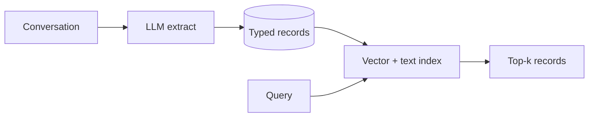
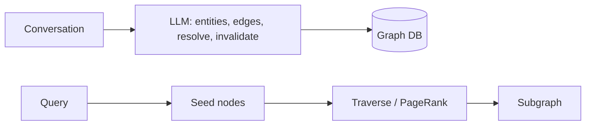
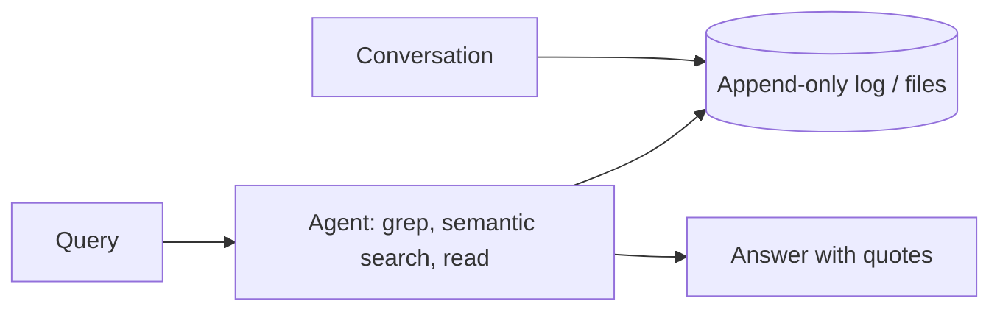
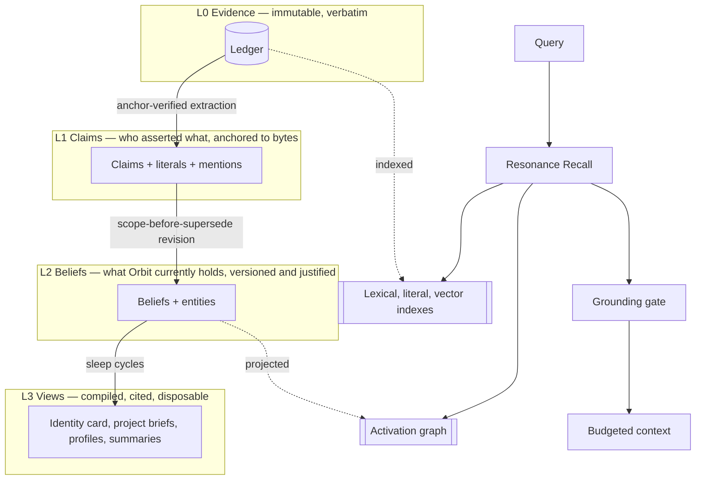

# 04 · Architecture options and the decision

> **What this document decides:** which of four materially different architectures Orbit should be. Recommendation: **Option D, the Evidential Memory Architecture** — a verbatim ledger with justified, versioned beliefs and a derived association graph. It is the most complex of the four; this page explains why the complexity is bought on purpose and how it is kept from becoming a liability.

## 1. The four options

### Option A — Structured records ("fact store")

An LLM turns each interaction into typed records (preferences, facts, decisions) in relational tables, with a vector and a text index over them. New records are reconciled against old ones with add / update / delete. This is Mem0, LangMem and most MCP memory servers.

- **For:** simple, cheap to read, easy to show in a UI, predictable latency.
- **Against:** what the extractor missed is gone; what it paraphrased is corrupted; updates destroy history; association is whatever the embedding happens to capture; episodes cannot be reconstructed. Exactness depends entirely on a model copying strings correctly.

### Option B — Graph-centric ("temporal knowledge graph")

The knowledge graph *is* the memory: entities, typed fact edges with validity intervals, communities. Retrieval is traversal. This is Graphiti, HippoRAG, GraphRAG and Cognee.

- **For:** real multi-hop association; relationships and time are native; good global structure.
- **Against:** the highest write cost of any option; entity-resolution mistakes compound silently; triples flatten nuance, modality and reasons; a graph database becomes the thing you operate and isolate per tenant; simple factual recall can get *worse* than plain retrieval when edges replace passages.

### Option C — Log-centric ("verbatim + search")

Keep everything raw — a log or a set of files — and let search and the reading model do the work at query time. Almost nothing happens at write time. This is Letta's filesystem result, and Mastra's observational log is its compressed cousin.

- **For:** lossless, exact, trivially correct provenance, robust to model changes, almost free to write.
- **Against:** every question pays the full cost of understanding; no consolidation, so no identity model, no project state, no contradiction handling; quality rests on the diligence of whichever model is reading; unindexed, it does not reach 10⁸ tokens.

### Option D — Evidential Memory Architecture (recommended)

Keep C's ledger as the only source of truth. Derive A's structure from it, but as **versioned beliefs justified by anchored claims** instead of mutable records. Derive B's graph from those, but as an **in-memory index** instead of a database. Add offline consolidation between the layers.

- **For:** lossless *and* structured *and* associative; every derived item can be traced, re-derived or retracted; the cheap path (search the ledger) always works.
- **Against:** the most moving parts; derived layers can drift from one another; needs an evaluation harness to keep honest; slower to first release.

## 2. Comparison

Scores are relative judgements (● strong, ◐ partial, ○ weak) from the analysis in [03](03-prior-art.md), not measurements.

| Criterion | A Records | B Graph | C Log | D Evidential |
|---|:-:|:-:|:-:|:-:|
| Exact recall of literals | ○ | ○ | ● | ● |
| Episodic reconstruction | ○ | ◐ | ● | ● |
| Temporal correctness, history | ○ | ● | ◐ | ● |
| Associative / multi-hop recall | ○ | ● | ◐ | ● |
| Stated vs inferred separation | ○ | ○ | ● (nothing is inferred) | ● |
| Identity and project state | ◐ | ◐ | ○ | ● |
| Correctable and re-derivable | ○ | ◐ | ● | ● |
| Write cost | ◐ | ○ | ● | ◐ (salience-gated) |
| Read latency | ● | ● | ○ | ● fast path, ◐ deep path |
| Scales to 10⁸–10⁹ tokens | ◐ | ◐ | ○ | ● |
| Independent of any one model | ○ | ○ | ● | ● |
| Resistance to memory poisoning | ○ | ○ | ◐ | ● |
| Implementation effort | ● | ◐ | ● | ○ |
| Operational simplicity | ● | ○ | ● | ◐ |

## 3. Why D

**The deciding argument is asymmetry of error.** In A and B, a mistake at write time is unrecoverable because the source is gone or demoted. In C, nothing is ever wrong but nothing is ever learned. D is the only option where a wrong extraction, a bad entity merge, a poor summary or an obsolete embedding model can all be fixed by re-deriving from evidence — which is also the only way to honour "must not depend on a single embedding model or LLM provider" in practice rather than in principle.

**The second argument is that the hard requirements need different layers.**

| Requirement | Needs |
|---|---|
| Exact command recall | L0 bytes |
| "What did I discuss with Claude last September?" | L0 + episodes |
| "What's my preference for X in project Y?" | L2 belief with scope |
| "Why did I reject that architecture?" | L2 lineage + L1 rationale + L0 quotes |
| "How has the plan changed?" | L2 versions over time |
| "What else does this remind me of?" | Graph over L2 and episodes |
| "Brief a coding agent in 1,500 tokens" | L3 view, cited down to L2 |

No single-layer architecture answers all seven.

## 4. What D costs, and how each cost is contained

| Cost | Containment |
|---|---|
| **Complexity** | Layers are strictly ordered and each is disposable: delete L3, L2 and L1 and the system still answers questions as Option C. Phases in the [roadmap](../validation/17-roadmap-risks.md) ship in that order. |
| **Drift between layers** | Dependencies are explicit (justification graph). A change below marks everything above it dirty. |
| **Write cost** | Extraction depth is gated by salience; low-salience evidence is indexed raw and extracted only if it is ever retrieved. |
| **Unproven mechanisms** | Each is tagged *Hypothesis* and has an ablation. Anything that does not beat the simpler variant is deleted. |
| **Time to first value** | Phase 0 is literally Option C with good indexes — useful by itself, and the baseline every later layer must beat. |

## 5. Assumptions, and how to test them

| Assumption | If false | Test |
|---|---|---|
| Mechanical verification (quote location, entailment, literal checks) makes cheap-model extraction trustworthy | Extraction needs a stronger model: ~10× cost | Extraction precision/recall vs human labels, by model tier |
| Beliefs improve on raw retrieval for preference, decision and state questions | Skip L2 for those kinds; keep it for project memory only | D vs C on the OrbitBench update / temporal / identity suites |
| A per-user in-memory graph gives a measurable associative gain at acceptable cost | Drop spreading; keep channel fusion | Spread on/off ablation on multi-hop and cross-conversation suites |
| Offline consolidation is worth its LLM spend | Reduce to nightly tidy-up only | Answer quality and context tokens with and without L3 views |
| Users will review a small queue of uncertain items | Inferences stay `inferred` forever (safe, less useful) | Review acceptance and response rates in dogfooding |

## 6. Decision record

- **Chosen:** Option D.
- **Rejected:** A (irrecoverably lossy), B as the store (cost, compounding resolution errors, operations), C alone (no learning, no scale).
- **Kept from each:** A's typed, queryable structure; B's temporal edges and graph traversal; C's ledger, which doubles as the fallback.
- **Revisit if:** the Phase 1 evaluation shows L2 does not beat the Phase 0 baseline on the suites it exists for.
