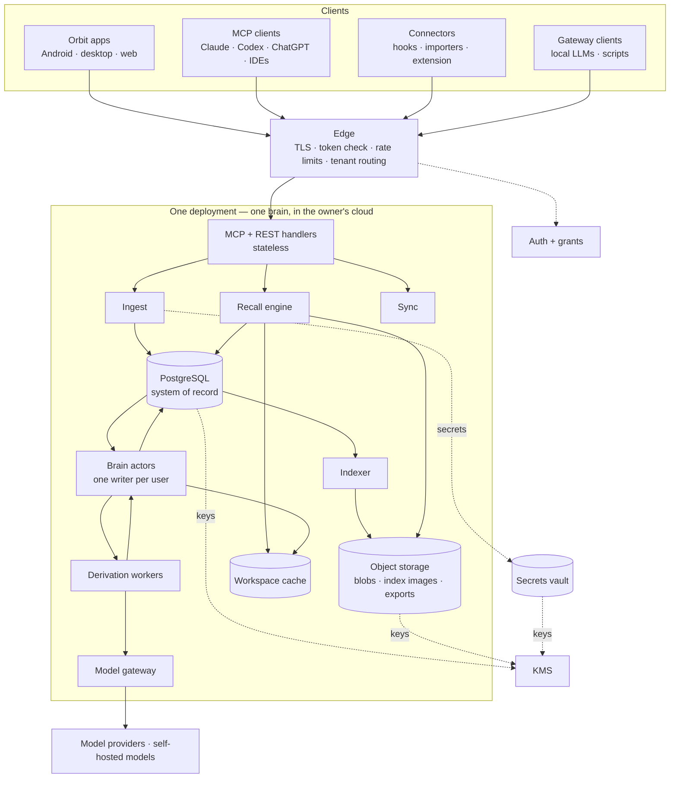
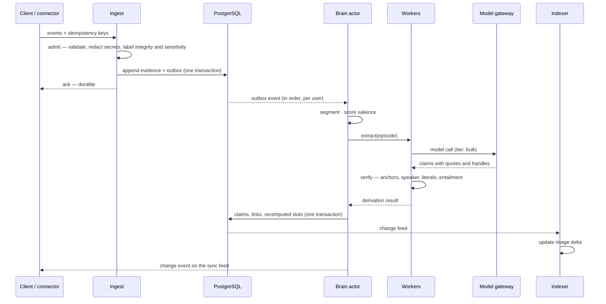
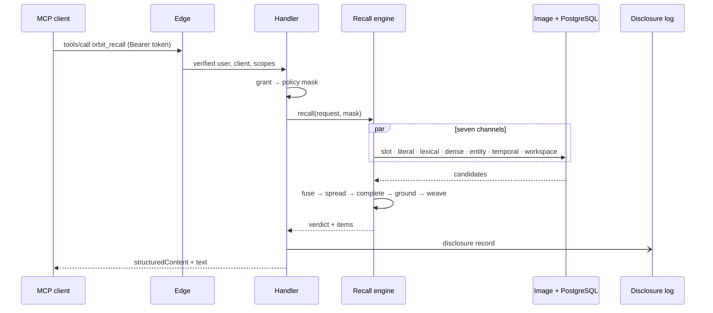
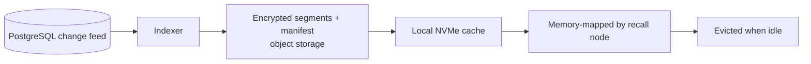

# 12 · System design

> **What this document decides:** the services, the data flows, how concurrent writes stay consistent, how devices sync, and how one deployment serves one brain in the owner's cloud while staying upgradeable. Schemas are in [13](13-data-model.md); technology choices in [14](14-tech-stack.md).

## 1. Overview

Three ideas organise it:

1. **One durable log, many disposable projections.** PostgreSQL holds the evidence ledger and the derived tables. Indexes, graph, views and caches are projections that can be rebuilt.
2. **One writer per brain.** All state changes for a user are applied serially by that user's *brain actor*. Model calls run in parallel workers; their results are applied by the actor.
3. **One index bundle per brain.** Retrieval runs in a single process over a per-user *brain image*, not across several shared databases.

## 2. Components

| Component | Responsibility | State |
|---|---|---|
| **Edge** | TLS, token validation, rate limiting | None |
| **Auth + grants** | OAuth 2.1 / OIDC authorization server; passkeys; client registration; consent and grant management | Own database |
| **MCP + REST handlers** | Protocol translation; grant → policy mask; request validation | None |
| **Ingest** | Admission (validate, redact secrets, label), ledger append, outbox | Writes PostgreSQL |
| **Brain actor** | Segmentation, salience, slot recompute, working memory, change feed — in order, per user | Owns a user's derived state |
| **Derivation workers** | Extraction, verification, linking, consolidation cycles | None; idempotent |
| **Model gateway** | Provider-agnostic calls by tier; prompt registry; batching; caching; budgets; routing by sensitivity | Prompt and derivation registry |
| **Indexer** | Builds and compacts brain images from the change feed | Writes object storage |
| **Recall engine** | Resonance Recall over the image + fresh rows | Memory-mapped images (cache) |
| **Sync** | Per-device cursors over the change feed; outbox upload | Cursors |
| **Workspace cache** | Working memory and hot briefs | Volatile; durable copy in PostgreSQL |
| **Vault** | Credentials, isolated | Own store and key |

At the start these are modules of two deployables — an engine and a worker pool — not ten services.

## 3. Write path

- The acknowledgement comes after the append and before any model runs.
- If a model or worker fails, the evidence is already searchable; the derivation is retried.
- The actor's transaction is the only place beliefs change.

## 4. Read path

No model is called on the fast path apart from one embedding. The disclosure record is written asynchronously but durably; it also opens the Echo Guard and reconsolidation window for that context handle.

## 5. Brain image

> **In a single-brain deployment** the image is simply the server's own retrieval index: built from PostgreSQL, kept on local disk, held in memory, and rebuilt on demand. The parts below about per-user bundles, object storage, eviction and cold start matter only for a hosted multi-user service (stage 3 in [§8](#8-deployment-model-and-upgrade-path)). The contents and the freshness rule apply either way.

A brain image is the per-user, read-optimised bundle of everything retrieval needs:

| Part | Contents |
|---|---|
| Lexical index | Evidence chunks with context prefix, claim and belief statements, summaries |
| Literal dictionary | Exact and normalised keys → anchors |
| Vectors | Quantised for search; fuller precision on disk for rescoring |
| Graph | Compressed adjacency with edge type, weight, validity and labels |
| Belief snapshot | Columnar current and historical versions, for slot lookups |
| Entity dictionary | Aliases → entities, with confusables |

**Why a bundle per user.** Orbit's shape is many small indexes, not one large one. Shared vector indexes filtered by tenant degrade and are a standing isolation risk; a graph database adds a network hop to an algorithm that wants memory locality. A heavy user's whole image is a few hundred megabytes ([16](../validation/16-cost-and-scale.md)), which fits comfortably in memory when that user is active and costs almost nothing in object storage when they are not.

**Structure.** Immutable segments plus a manifest, in the manner of a log-structured index. New writes land in an in-memory delta; background compaction folds them into segments. Readers hold a manifest version, so they see a consistent snapshot. A deletion forces compaction of the affected segments within the purge deadline.

**Lifecycle.**

**Freshness.** Each image records the last change-feed sequence it contains. A query merges the image with rows newer than that, read directly from PostgreSQL — so a memory written a second ago through one client is visible to another.

**Cold start.** A user not seen recently is served from PostgreSQL fallback queries while their image loads (target: a few hundred milliseconds for a typical brain).

**Format.** Two candidates: Lance tables per user (versioned columnar data with vector and BM25 indexes on object storage) plus a custom graph file; or a custom bundle built on Tantivy, a quantised vector file and compressed adjacency. Decided by a spike on cold-start time, filtered-search latency, compaction cost and deletion behaviour.

**Not needed on day one.** Until scale demands it, the same `RecallIndex` interface is implemented over PostgreSQL (pgvector, trigram and full-text indexes) with the graph loaded from the edge table on first use.

## 6. Brain actor: concurrency and consistency

**Model.** For each user there is one logical writer. Evidence can be appended from anywhere, concurrently; *derived state* changes only in that writer, one event at a time. Two clients writing at once therefore never race on a belief — there is no lock to contend for, because conflict is resolved by revision semantics over event time ([07](../architecture/07-consolidation.md)), not by who committed first.

| Guarantee | Mechanism |
|---|---|
| Evidence appends are durable, idempotent, commutative | Idempotency key; append-only; hash chain per user |
| Belief updates are serialisable per user | Single writer; one transaction per applied event |
| Belief state is independent of arrival order | Slot replay in event-time order (INV-9) |
| Read-your-writes | Evidence: immediately (lexical). Beliefs: after the fast path, seconds |
| Views are eventually consistent | Dirty flags; regenerated in sleep cycles (minutes to a day) |
| Change feed is monotonic | A per-user sequence number assigned in the actor's transaction |
| Handlers are idempotent under at-least-once delivery | Deterministic ids derived from inputs |

**Example.** Claude and Codex are open at once. In Claude the user says "use SQLite for the local replica"; a minute later, in Codex, "actually use libSQL". Both are appended as they arrive. The actor processes them in event-time order; the second supersedes the first in that slot; both clients' next recall returns libSQL with the history attached. Had the phone delivered the first statement an hour late, the slot would be replayed and the result would be the same.

**Implementation, staged.** First: a job table in PostgreSQL with a per-user advisory lock, concurrency one per user. Later: a partitioned log keyed by user, or virtual actors with leases. The contract — in-order, exactly-once *effect* per user — does not change.

**Re-derivation.** Every derived row records the derivation (engine version, model, prompt hash) that produced it. Upgrading an extractor creates a new *epoch* in shadow; it is evaluated against the old one, then switched atomically for a user. Knowledge gets blue/green deployment.

## 7. Sync across devices

First-party clients keep a local, encrypted SQLite replica of a **subset**: the workspace, identity card, cards and briefs for active projects, recent episodes, pinned items, and an outbox.

| Direction | Protocol |
|---|---|
| Down | The device holds a cursor into the user's change feed; the server streams rows changed since, filtered by the device's subscription |
| Up | The device uploads outbox events with idempotency keys; they are ordinary evidence |

There are no merge conflicts to resolve on devices. Evidence is a grow-only set; everything else is computed by the server from it. An edit made in the UI — on any device, online or not — is a `user_direct` evidence event. Two incompatible offline edits become two events, ordered by time and resolved by revision; if that cannot decide, the belief is `disputed` and goes to review.

CRDT libraries were considered and are unnecessary here: there is no shared mutable document, and the ledger already has the one CRDT property that matters.

Offline, the local replica answers lexical and small-scale vector queries over its subset using the same engine compiled for the device.

## 8. Deployment model and upgrade path

**Decision (2026-11-11).** Orbit is built first for its owner alone: one brain per deployment, running on a cloud server the owner controls, so that every device and every AI client can reach it. Once it works, others receive the same codebase and deploy it in their own cloud. A hosted service holding many people's brains is not planned for now, because holding other people's memories safely is a harder problem than building the memory.

**No memory feature is reduced by this.** Everything in documents 05–11 is unchanged. What is deferred is fleet infrastructure only.

| Stage | Who | Shape |
|---|---|---|
| **1 Personal** | The owner | One cloud deployment: engine, workers, PostgreSQL, an object-storage bucket. Retrieval indexes live in the engine process |
| **2 Self-hosted release** | Anyone, each in their own cloud account | The same code, packaged: one-command deploy, guided setup (domain, login, model keys), automatic migrations, backup and restore, upgrade path |
| **3 Hosted multi-user** — optional, not planned | Many people on shared infrastructure | Cells, a directory mapping users to cells, per-user index bundles on object storage, confidential computing |

### What one deployment contains

| Part | Runs as |
|---|---|
| Engine: API, MCP, ingest, brain actor, recall, indexer, sync | One process |
| Derivation workers | One worker pool |
| PostgreSQL | One instance (managed or on the same host), with point-in-time backups |
| Object storage | One bucket: large evidence bodies, exports, backups |
| Auth | The bundled authorization server, with the owner as the only user |
| Secrets vault | A separate store and key |
| Model access | The owner's own provider keys, or a self-hosted model |

A decade of one heavy user's memory is single-digit gigabytes ([16](../validation/16-cost-and-scale.md)), so one modest server is enough and there is a great deal of vertical headroom. Scaling a personal brain means a larger machine, not a distributed system.

### Seams kept so an upgrade is additive

Each costs almost nothing now and avoids a rewrite later.

| Seam | Now | If stage 3 ever happens |
|---|---|---|
| `tenant_id` on every table, with row-level security | One constant value | Many values |
| OAuth login and per-client grants | Needed anyway: Claude, Codex and ChatGPT are separate clients with different grants | Unchanged |
| Retrieval behind the `RecallIndex` interface | In-process index over PostgreSQL | Per-user images on object storage |
| Keys behind a `KeyProvider` | One owner key in the cloud provider's KMS | Per-user keys; attested workloads |
| One writer per brain | The only writer | One per user, partitioned |
| Export bundle | Backup, and moving a brain between deployments | Onboarding and offboarding |

### What the owner of a deployment is responsible for

Self-hosting moves trust from a vendor to the owner, and with it some duties: keeping the server patched, protecting the domain and login, holding the backup and encryption keys, and paying for the server and for model usage. Stage 2 exists to make these as close to automatic as possible.

## 9. Local brain mode

A secondary mode. The deployment Orbit is designed around is a cloud server; this section describes running the same engine on a single machine.

Because the engine is a library and the source of truth is a log, the same code can run on one machine: SQLite in place of PostgreSQL, the image on local disk, local models through the gateway. This serves development, privacy-maximal users, and offline use. Extraction quality depends on the local model; everything mechanical — the ledger, anchors, exact recall, revision, retrieval — is identical. A local brain can later be uploaded to the cloud, or a cloud brain exported to run locally, since both are the same bundle ([11 §9](../architecture/11-security-privacy.md#9-ownership-inspect-correct-export-delete)).

## 10. What runs where

| | Cloud | Device |
|---|---|---|
| Source of truth | Ledger and derived tables | — (cache + outbox only) |
| Capture | Gateway, imports | Apps, hooks, extension, transcript readers, voice |
| Secret redaction | At admission | Also before upload, so secrets do not leave the device |
| Extraction and consolidation | Yes | No (optionally in local-brain mode) |
| Retrieval | Full | Subset, offline |
| Working memory | Authoritative | Mirrored |
| Keys | KMS-wrapped tenant keys | Device keystore for the replica; user-held key in stage 3 |

## 11. Reliability

- **Backups:** point-in-time recovery for PostgreSQL; versioned object storage. The ledger is replicated across regions; everything else can be rebuilt from it.
- **Restore drill:** rebuild a brain from the ledger and the derivation log, and compare state hashes (this is also invariant INV-1's test).
- **Degraded modes:** model provider down → ingestion and raw indexing continue, fast-path recall unaffected, derivation queues. Image unavailable → PostgreSQL fallback. PostgreSQL read replica lag → fresh-row merge reads from the primary.
- **Backpressure:** per-user derivation budgets; overflow lowers extraction tier instead of dropping evidence.
- **Migrations:** schema changes are additive; embedding models change by adding a space and backfilling; extractor changes by epoch.

## 12. Observability

OpenTelemetry traces end to end, propagating the trace context MCP now carries in request metadata. Key signals: ack latency; derivation lag per user; extraction rejection rates by reason; recall latency by path and intent; verdict distribution; correction and review rates; cost per user. Retrieval logs double as evaluation data ([15](../validation/15-evaluation.md)). Logs and traces carry ids, never content.

## 13. Decisions

| Decision | Alternatives | Why this | Cost | Test |
|---|---|---|---|---|
| Log + projections | Mutable primary state | Re-derivation, audit, deletion, model independence | Projection lag; more storage | Replay equals live state |
| Single writer per user | Optimistic concurrency on beliefs; CRDTs | Simple, serialisable, no merge logic | Per-user throughput ceiling (ample for one person) | Concurrent-client tests |
| Per-user brain image | Shared vector DB + graph DB + search cluster | Locality, isolation, cost at many small tenants | Custom indexing work | Latency and cost at simulated scale |
| One brain per deployment, in the owner's cloud | A hosted service for many users | Nobody else's data to protect; simplest operations; strongest privacy; no feature cut | Each owner runs a server | Fresh-install, upgrade and restore drills |
| Server computes derived state; devices hold replicas | Local-first with merge | One revision engine; consistent results | Needs connectivity for full recall | Offline scenarios |
| PostgreSQL first, images later | Build images from day one | Time to a working system | A migration later (behind an interface) | Same suites pass on both backends |
