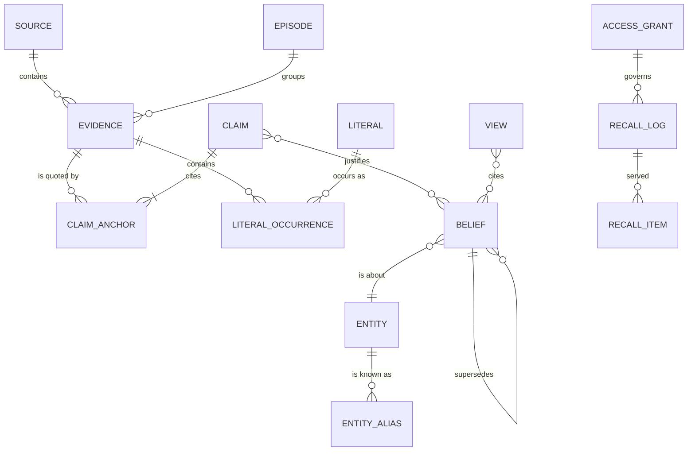

# 13 · Data model

> **What this document decides:** the reference schema for the system of record (PostgreSQL 18). It is abbreviated — secondary indexes and row-level-security policies are shown once — but every table and every column that an invariant depends on is here. Concepts are defined in [05](../architecture/05-memory-model.md).

## 1. Map



## 2. Conventions

- Every table has `tenant_id`; row-level security is forced on all of them. With one brain per deployment it holds a single constant value; it is kept so that a multi-user service would be an addition, not a migration.
- Ids are UUIDv7 (time-ordered), shown to clients with a type prefix: `ev_`, `src_`, `ep_`, `cl_`, `bl_`, `en_`, `lt_`, `vw_`, `ctx_`, `gr_`.
- Every derived row carries `derivation_id`: which engine version, model and prompt produced it.
- Time: `occurred_at` / `asserted_at` / `valid` are **event or valid time**; `recorded_at` / `believed` are **system time**.
- Text that may contain exact strings is stored as a *template* (`_tpl`) with handles, never as free text.

```sql
create extension if not exists vector;       -- embeddings (early phases)
create extension if not exists pg_trgm;      -- literal lookup
create extension if not exists btree_gist;   -- temporal exclusion constraints

-- Ordered enums: comparisons and min/max follow declaration order.
create type integrity   as enum ('external', 'agent', 'user_relayed', 'user_artifact', 'user_direct');
create type sensitivity as enum ('public', 'work', 'personal', 'sensitive');
create type basis       as enum ('assumed', 'inferred', 'reported', 'observed', 'stated');
create type standing    as enum ('disputed', 'unconfirmed', 'confirmed');
create type lifecycle   as enum ('current', 'superseded', 'retracted', 'expired');
```

## 3. L0 — evidence

```sql
create table source (
  tenant_id    uuid not null,
  source_id    uuid not null default uuidv7(),
  kind         text not null,          -- conversation | document | repo_file | transcript | import | note
  client_id    text,                   -- OAuth client or connector that delivered it
  app          text,                   -- 'claude-desktop', 'codex', 'chatgpt-export', …
  model        text,                   -- model id for assistant turns, if known
  external_ref text,                   -- provider conversation id, path@commit, URL
  title        text,
  started_at   timestamptz,
  ended_at     timestamptz,
  project_id   uuid,                   -- resolved binding; nullable
  integrity    integrity   not null,
  sensitivity  sensitivity not null default 'work',
  dek_ref      text,                   -- wrapped per-source content key
  meta         jsonb not null default '{}',
  primary key (tenant_id, source_id)
);

create table evidence (
  tenant_id       uuid not null,
  evidence_id     uuid not null default uuidv7(),
  source_id       uuid not null,
  seq             int  not null,                 -- order within the source
  episode_id      uuid,                          -- assigned by segmentation
  author_role     text not null,                 -- user | assistant | tool | system | third_party
  author_ref      text,                          -- model id, tool name, or person entity
  occurred_at     timestamptz not null,          -- event time
  recorded_at     timestamptz not null default now(),
  content         bytea,                         -- exact bytes, encrypted under the source key
  content_ref     text,                          -- object-storage key for large bodies
  content_sha256  bytea not null,
  quoted_ranges   int4multirange,                -- byte ranges detected as pasted / quoted third-party text
  integrity       integrity   not null,
  sensitivity     sensitivity not null,
  taint           text[] not null default '{}',  -- instruction_like | secret_redacted | …
  idempotency_key text not null,
  prev_hash       bytea,                         -- per-tenant hash chain
  row_hash        bytea not null,
  erased_at       timestamptz,                   -- tombstone; content key destroyed
  primary key (tenant_id, evidence_id),
  unique (tenant_id, idempotency_key),
  unique (tenant_id, source_id, seq)
) partition by hash (tenant_id);

-- Append-only: the application role may INSERT; a trigger permits UPDATE of erased_at / episode_id only.

create table episode (
  tenant_id   uuid not null,
  episode_id  uuid not null default uuidv7(),
  parent_id   uuid,                              -- session → episode; general event → period
  level       text not null,                     -- episode | general_event | period
  source_id   uuid,
  project_id  uuid,
  span        tstzrange not null,
  setting     jsonb not null default '{}',       -- client, model, device, participants
  summary_tpl text,                              -- handle-locked; derived
  salience    real,
  tier        smallint not null default 0,       -- 0 raw · 1 light · 2 full
  derivation_id uuid,
  primary key (tenant_id, episode_id)
);
```

## 4. Literals and entities

```sql
create table literal (                           -- one row per distinct exact value
  tenant_id   uuid not null,
  literal_id  uuid not null default uuidv7(),
  kind        text not null,                     -- command | path | url | version | identifier | number | date | config | hash | quote | term
  exact       text not null,                     -- byte copy of an anchor; never generated
  norm        text not null,                     -- lookup key only
  primary key (tenant_id, literal_id),
  unique (tenant_id, kind, exact)
);
create index literal_norm_trgm on literal using gin (norm gin_trgm_ops);

create table literal_occurrence (
  tenant_id   uuid not null,
  literal_id  uuid not null,
  evidence_id uuid not null,
  byte_start  int  not null,
  byte_end    int  not null,
  span_sha256 bytea not null,
  role        text not null,                     -- typed_by_user | suggested_by_assistant | tool_output | document
  primary key (tenant_id, literal_id, evidence_id, byte_start)
);

create table entity (
  tenant_id      uuid not null,
  entity_id      uuid not null default uuidv7(),
  type           text not null,                  -- person | org | project | component | technology | product | place | event | concept | artifact | term
  canonical_name text not null,
  category       text,                           -- e.g. technology → database
  external_ids   jsonb not null default '{}',    -- {"git_remote": "…", "package": "crates.io/tokio", "url": "…"}
  cluster_id     uuid not null,                  -- current resolution cluster: derived, reversible
  sensitivity    sensitivity not null default 'work',
  primary key (tenant_id, entity_id)
);

create table entity_alias (
  tenant_id uuid not null, entity_id uuid not null,
  alias text not null, norm text not null,
  evidence_id uuid, byte_start int, byte_end int,
  primary key (tenant_id, entity_id, norm)
);

create table entity_link (                       -- soft identity: assertions, not merges
  tenant_id   uuid not null,
  a_id        uuid not null,
  b_id        uuid not null,
  relation    text not null check (relation in ('same_as', 'different_from', 'confusable_with')),
  confidence  real not null,
  asserted_by text not null,                     -- system | user  (user assertions are absolute)
  derivation_id uuid,
  primary key (tenant_id, a_id, b_id, relation)
);

create table mention (
  tenant_id uuid not null, evidence_id uuid not null,
  byte_start int not null, byte_end int not null,
  entity_id uuid,                                -- null while unresolved
  candidates jsonb,                              -- provisional links with scores
  primary key (tenant_id, evidence_id, byte_start)
);

create table project_binding (
  tenant_id uuid not null, project_id uuid not null,
  kind text not null,                            -- git_remote | root_commit | package | folder
  fingerprint text not null,
  confirmed boolean not null default false,
  primary key (tenant_id, kind, fingerprint)
);
```

## 5. L1 — claims

```sql
create table claim (
  tenant_id         uuid not null,
  claim_id          uuid not null default uuidv7(),
  source_id         uuid not null,
  episode_id        uuid,
  speaker_role      text not null,               -- user | assistant | third_party | document | tool
  speaker_ref       text,
  act               text not null,               -- assert | prefer | decide | plan | commit | instruct | correct | reject
                                                 -- | ask | hypothesize | define | report | evaluate | rationale | ratify
  subject_id        uuid,
  predicate         text,
  object_entity_id  uuid,
  object_literal_id uuid,
  object_value      jsonb,
  scope             jsonb not null default '{}',
  polarity          smallint not null default 1,
  modality          text,                        -- firm | tentative
  statement_tpl     text not null,               -- self-contained, handle-locked
  asserted_at       timestamptz not null,        -- when it was said (event time)
  valid_hint        tstzrange,                   -- the time the claim says it is about
  explicitness      text not null,               -- explicit | implicit
  refers_to_claim   uuid,                        -- rationale-for / ratifies / corrects
  echo_of_belief    uuid,                        -- Echo Guard: restates something Orbit served
  extract_conf      real not null,
  entail_score      real,
  integrity         integrity   not null,        -- min over anchors
  sensitivity       sensitivity not null,        -- max over anchors
  derivation_id     uuid not null,
  retracted_at      timestamptz,
  retract_reason    text,
  primary key (tenant_id, claim_id)
) partition by hash (tenant_id);

create table claim_anchor (                      -- INV-2: every claim cites bytes
  tenant_id   uuid not null,
  claim_id    uuid not null,
  evidence_id uuid not null,
  byte_start  int  not null,
  byte_end    int  not null,
  span_sha256 bytea not null,
  role        text not null default 'content',   -- content | ratification | context
  primary key (tenant_id, claim_id, evidence_id, byte_start)
);
```

## 6. L2 — beliefs

```sql
create table belief (                            -- one row per VERSION
  tenant_id         uuid not null,
  belief_id         uuid not null default uuidv7(),
  slot_id           uuid not null,               -- (subject, predicate, scope) or (+ object) for multi-valued predicates
  kind              text not null,               -- identity.preference | project.decision | procedural.convention | …
  subject_id        uuid not null,
  predicate         text not null,
  object_entity_id  uuid,
  object_literal_id uuid,
  object_value      jsonb,
  scope             jsonb not null default '{}', -- {"project": "…", "component": "…", "domain": "…"}
  scope_key         text  not null,              -- canonical form, for equality and specificity tests
  statement_tpl     text  not null,
  valid             tstzrange not null,          -- valid time
  believed          tstzrange not null default tstzrange(now(), null),   -- system time
  basis             basis     not null,
  standing          standing  not null default 'unconfirmed',
  lifecycle         lifecycle not null default 'current',
  confidence        real not null,               -- computed and calibrated; never model-asserted
  integrity         integrity   not null,
  sensitivity       sensitivity not null,
  compartment_id    uuid,                        -- project or named compartment
  stability         text,                        -- state | phase | trait  (identity kinds)
  importance        real not null default 0,     -- activation floor
  supersedes        uuid,                        -- previous version
  status_detail     jsonb,                       -- decision status, task state, …
  derivation_id     uuid not null,
  primary key (tenant_id, belief_id),

  -- INV-4: at most one current, still-believed version per slot at any valid instant
  exclude using gist (tenant_id with =, slot_id with =, valid with &&)
    where (lifecycle = 'current' and upper_inf(believed))
) partition by hash (tenant_id);

create index belief_slot    on belief (tenant_id, subject_id, predicate, scope_key) where upper_inf(believed);
create index belief_kind    on belief (tenant_id, kind, compartment_id)             where lifecycle = 'current';
create index belief_valid   on belief using gist (tenant_id, valid);

create table justification (                     -- the truth-maintenance graph
  tenant_id  uuid not null,
  belief_id  uuid not null,
  claim_id   uuid not null,
  role       text not null,                      -- supports | attacks | rationale | ratifies | corrects
  weight     real not null,
  indep_group text not null,                     -- episode-day bucket: repetition within a group counts once
  primary key (tenant_id, belief_id, claim_id, role)
);

create table predicate_def (                     -- the registry (global defaults + per-tenant extensions)
  tenant_id   uuid,                              -- null = built-in
  predicate   text not null,
  cardinality text not null,                     -- functional | multi
  temporality text not null,                     -- fluent | rigid
  default_kind text not null,
  min_integrity integrity not null,
  default_sensitivity sensitivity not null
);

create table judgment (                          -- cached relation judgements → deterministic replay
  tenant_id uuid not null, a_id uuid not null, b_id uuid not null,
  derivation_id uuid not null,
  relation text not null,                        -- same | refines | contradicts | unrelated
  confidence real not null, rationale_tpl text,
  primary key (tenant_id, a_id, b_id, derivation_id)
);
```

## 7. Graph, activation, views

```sql
create table edge (                              -- projected into the in-memory graph
  tenant_id uuid not null,
  edge_id   uuid not null default uuidv7(),
  src_kind  text not null, src_id uuid not null, -- entity | belief | episode | view | literal
  dst_kind  text not null, dst_id uuid not null,
  type      text not null,                       -- about | mentions | supported_by | in_scope | part_of | next | near_in_time
                                                 -- | supersedes | refines | specializes | contradicts
                                                 -- | rationale_for | alternative_to | depends_on | associated
  weight    real not null default 1,
  valid     tstzrange,
  basis     basis not null default 'observed',
  integrity integrity not null, sensitivity sensitivity not null, compartment_id uuid,
  derivation_id uuid,
  primary key (tenant_id, edge_id)
) partition by hash (tenant_id);

create table activation (                        -- O(1) base-level state per node
  tenant_id uuid not null, node_kind text not null, node_id uuid not null,
  recent    timestamptz[] not null default '{}', -- last k weighted use events
  recent_w  real[] not null default '{}',
  n_total   int not null default 0,
  first_at  timestamptz,
  primary key (tenant_id, node_kind, node_id)
);

create table view (
  tenant_id uuid not null, view_id uuid not null default uuidv7(),
  kind      text not null,                       -- identity_card | project_card | project_brief | entity_profile
                                                 -- | topic_summary | period_summary | procedure
  subject_id uuid, section text,
  version   int not null,
  body_tpl  text not null,                       -- handle-locked; ⟦bl:…⟧ citation on every sentence
  cites     uuid[] not null,                     -- belief ids → dirty tracking
  dirty     boolean not null default false,
  sensitivity sensitivity not null, compartment_id uuid,
  built_at  timestamptz not null, derivation_id uuid not null,
  primary key (tenant_id, view_id, version)
);

create table embedding_s1 (                      -- one table per embedding space; early phases only
  tenant_id uuid not null, node_kind text not null, node_id uuid not null,
  v halfvec(1024) not null,
  primary key (tenant_id, node_kind, node_id)
) partition by hash (tenant_id);
```

## 8. Working and prospective memory

```sql
create table attention_session (                 -- what a context_handle names
  tenant_id uuid not null, ctx_id text not null,
  client_id text not null, grant_id uuid not null,
  project_id uuid, brief_version int,
  opened_at timestamptz not null default now(),
  last_seen_at timestamptz not null default now(),
  expires_at timestamptz not null,
  primary key (tenant_id, ctx_id)
);

create table working_item (
  tenant_id uuid not null, item_id uuid not null default uuidv7(),
  kind text not null,                            -- focus | task | open_question | recent_decision | handoff | observation
  ref_kind text, ref_id uuid,                    -- pointer into long-term memory
  text_tpl text,
  project_id uuid, client_id text,
  strength real not null default 1,
  refreshed_at timestamptz not null default now(),
  expires_at timestamptz not null,
  primary key (tenant_id, item_id)
);

create table intention (
  tenant_id uuid not null, intention_id uuid not null default uuidv7(),
  belief_id uuid not null,                       -- the underlying prospective.intention
  trigger   jsonb not null,                      -- {"type":"time","due":"…"}
                                                 -- {"type":"event","when":{"project":"…","component":"…","entity":"…"}}
                                                 -- {"type":"activity","after":"…"}
  status    text not null default 'open',        -- open | surfaced | done | cancelled | expired
  surfaced_count int not null default 0, last_surfaced_at timestamptz,
  primary key (tenant_id, intention_id)
);
```

## 9. Access, disclosure, review, audit

```sql
create table access_grant (
  tenant_id uuid not null, grant_id uuid not null default uuidv7(),
  client_id text not null,                       -- OAuth client (metadata-document URL or registered id)
  label text, profile text,                      -- coding_agent | general_assistant | read_only | full | custom
  kinds text[] not null,                         -- glob patterns over belief kinds
  compartments uuid[],                           -- null = all
  max_sensitivity sensitivity not null,
  min_integrity   integrity   not null default 'user_relayed',
  evidence_access text not null,                 -- none | quotes | full
  can_write boolean not null default false,
  daily_token_budget int, expires_at timestamptz, revoked_at timestamptz,
  primary key (tenant_id, grant_id)
);

create table recall_log (                        -- the disclosure ledger
  tenant_id uuid not null, recall_id uuid not null default uuidv7(),
  at timestamptz not null default now(),
  client_id text not null, grant_id uuid not null, ctx_id text,
  tool text not null, query_enc bytea, plan jsonb,
  verdict text not null,                         -- grounded | partial | conflicting | not_found
  confidence real, latency_ms int, tokens int,
  primary key (tenant_id, recall_id)
);

create table recall_item (
  tenant_id uuid not null, recall_id uuid not null,
  node_kind text not null, node_id uuid not null,
  rank int not null, score real, resolution text,   -- gist | statement | quote | excerpt
  outcome text,                                     -- served | used | corrected | ignored
  primary key (tenant_id, recall_id, node_kind, node_id)
);

create table review_item (
  tenant_id uuid not null, review_id uuid not null default uuidv7(),
  kind text not null,                            -- dispute | inference | entity_merge | pending_write | sensitivity
  subject jsonb not null, priority real not null,
  status text not null default 'open', resolved_by_evidence uuid,
  primary key (tenant_id, review_id)
);

create table derivation (
  derivation_id uuid primary key default uuidv7(),
  stage text not null,                           -- extract | verify | link | relate | summarize | embed | revise
  engine_version text not null, model_id text, prompt_sha256 bytea, params jsonb,
  epoch int not null, created_at timestamptz not null default now()
);

create table audit_log (                         -- append-only, hash-chained
  tenant_id uuid not null, seq bigint not null,
  at timestamptz not null default now(),
  actor text not null, action text not null, subject jsonb,
  prev_hash bytea, row_hash bytea not null,
  primary key (tenant_id, seq)
);

create table outbox (                            -- change feed; per-tenant monotonic sequence
  tenant_id uuid not null, tenant_seq bigint not null,
  topic text not null, payload jsonb not null,
  primary key (tenant_id, tenant_seq)
);
```

Row-level security, shown once:

```sql
alter table belief enable row level security;
alter table belief force  row level security;
create policy tenant_isolation on belief
  using (tenant_id = current_setting('orbit.tenant_id')::uuid);
```

## 10. Where each invariant lives

| Invariant | Schema or mechanism |
|---|---|
| INV-1 Evidence immutable | Insert-only privileges; trigger; `row_hash` chain |
| INV-2 Everything cites bytes | `claim_anchor` (≥ 1 per claim, checked in the actor's transaction); `span_sha256` |
| INV-3 Exact strings copied | `literal.exact` filled only from an anchor; `*_tpl` columns hold handles; validator on every write |
| INV-4 No in-place edits | Version rows; exclusion constraint on `(slot, valid)` |
| INV-5 Basis ratchet | Revision function; `claim.echo_of_belief`; `justification.indep_group` |
| INV-6 Integrity floors | `predicate_def.min_integrity`; `integrity` computed as a minimum |
| INV-7 Non-interference | `integrity`, `sensitivity`, `compartment_id` on beliefs, edges and views → mask |
| INV-8 Erasure propagates | `justification` → retraction → `view.dirty` |
| INV-9 Order independence | `claim.asserted_at` ordering; `judgment` cache; slot recompute |
| INV-10 Measured claims | `derivation.epoch` ties every row to an evaluated configuration |

## 11. Shapes

```jsonc
// scope — a set of constraints; more keys = more specific
{ "project": "en_01J…", "component": "en_01J…", "domain": "systems-programming", "activity": "coding" }

// belief.status_detail for a decision
{ "status": "accepted", "decided_at": "2026-03-09", "alternatives": ["bl_01J…"], "consequences": ["bl_01J…"] }

// setting on an episode
{ "client": "claude-desktop", "model": "…", "device": "laptop", "participants": ["user", "assistant"] }
```
