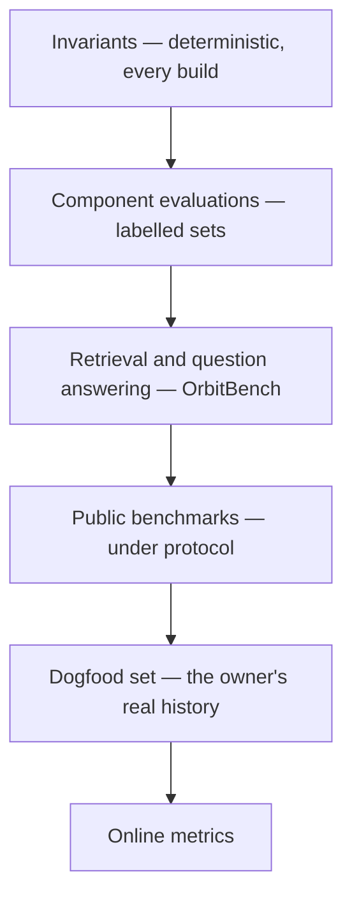
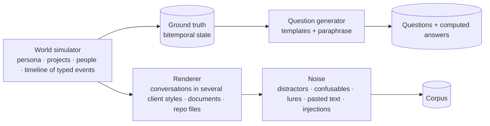

# 15 · Evaluation

> **What this document decides:** how to know whether the memory works. Demonstrations do not count. Three kinds of evidence do: invariants that must hold on every build, measured suites with ground truth that is computed and not judged, and public benchmarks run under a protocol strict enough to mean something.

## 1. Principles

1. **Programmatic ground truth first.** Where an answer can be checked by string equality, set comparison or date arithmetic, it is. Model judges are a last resort, validated against human labels.
2. **Test at the scale that matters.** Results at 10⁵ tokens of history say little about 10⁸.
3. **Measure what the brief asks for and what public suites omit:** exactness, provenance, epistemic status, corrections, permissions, injection.
4. **Every mechanism has an ablation.** Anything that does not beat the simpler variant is removed.
5. **Report cost and latency beside accuracy,** always.

## 2. Layers

## 3. Invariants

Deterministic properties, run in CI on synthetic corpora. A failure blocks release.

| | Property | Test |
|---|---|---|
| INV-1 | Derived state is rebuildable | Replay the ledger with the recorded derivations; state hashes match |
| INV-2 | Provenance | Every claim, belief and view sentence resolves to anchors whose hashes match |
| INV-3 | Exactness | Every literal in every rendered output is byte-identical to an anchor — including adversarial strings (look-alike characters, long hashes, near-identical versions) |
| INV-4 | History | After any sequence of updates, every earlier version is retrievable as-of its time |
| INV-5 | Basis ratchet | No belief is `stated` without an explicit user-channel claim; echoed content never raises basis |
| INV-6 | Integrity floors | No identity, procedural or convention belief rests on `agent` or `external` evidence |
| INV-7 | Non-interference | Results under a grant equal results on a brain with out-of-grant data removed |
| INV-8 | Erasure | After deleting evidence, no output contains its spans and its sole dependents are retracted |
| INV-9 | Order independence | Shuffling ingestion order yields the same belief state |
| — | Tenant isolation | Randomised cross-tenant probes return nothing |

## 4. Component evaluations

| Component | Metric | Ground truth |
|---|---|---|
| Claim extraction | Precision, recall, F1; speech-act accuracy; rejection reasons | Human-annotated episodes |
| Anchoring | Share of claims with valid anchors (should be 100% by construction); entailment precision | Annotated |
| Literal detection | Recall by kind | Synthetic and annotated |
| Segmentation | Boundary F1, WindowDiff | Annotated |
| Entity resolution | B³ / CEAF F1; false-merge rate | Simulator |
| Relation judgement (same / refines / contradicts) | Accuracy; confusion matrix | Simulator + annotated |
| Revision | Outcome accuracy by case: scope, change, correction, noise | Simulator |
| Salience | nDCG against "should have been remembered" labels | Annotated |
| Confidence | Expected calibration error, Brier score | Outcomes |
| Sensitivity and instruction-likeness classifiers | AUROC; false-negative rate | Labelled |

## 5. The suites the brief asks for

| Brief item | Suite | Measures | Ground truth |
|---|---|---|---|
| Exact recall | **Exact** | Exact-match on commands, identifiers, versions, URLs, numbers, quotes; role accuracy (typed vs suggested) | String equality |
| Semantic recall | **Semantic** | Answer accuracy on paraphrased fact questions; Recall@k, nDCG | Simulator state |
| Episodic recall | **Episode** | Correct episode(s) retrieved for who / where / when questions; completeness of the reconstruction | Simulator |
| Temporal recall | **Temporal** | As-of answers; first / last / original; evolution chains in order | Simulator (bitemporal) |
| Multi-hop retrieval | **Multi-hop** | Support recall — *all* needed memories retrieved; answer accuracy | Simulator |
| Cross-conversation retrieval | **Cross-client** | A fact written through client A, asked through client B, with correct attribution | Simulator |
| Project-context retrieval | **Project** | (i) Brief coverage and precision against true project state; (ii) task success for a reference coding agent with Orbit vs static file vs nothing; tokens used | Simulator + task tests |
| Contradiction handling | **Contradiction** | Disputes surfaced, not silently resolved; scoped pairs kept apart | Simulator |
| Memory update accuracy | **Update** | Change vs correction vs scope vs noise handled correctly; stale-answer rate | Simulator |
| Retrieval precision and recall | All of the above | Precision@k, Recall@k, MRR, nDCG by intent | Simulator |
| Hallucination rate | **Lure**, **Abstention** | False-memory rate at stated answer coverage; abstention precision / recall; calibration | Simulator (unanswerable and lure items) |
| Retrieval latency | — | p50 / p95 / p99 by path and intent, engine time and end to end | Measured |
| Storage and operating costs | — | Model tokens, compute, storage per 1M tokens ingested and per user-month | Measured ([16](16-cost-and-scale.md)) |

Additional suites: **Epistemic** (returned basis matches truth; violations = 0), **Echo** (served inferences fed back must not gain basis), **Scoped preference** (most specific applies), **Identity** (state vs trait), **Injection**, **Poisoning**, **Grant leak** (§8).

**Definitions.**

- *False-memory rate* — answers asserting something the ledger does not support ÷ answers given.
- *Stale rate* — "current" questions answered from a superseded belief.
- *Epistemic violation* — an item rendered with a stronger basis than the ground truth warrants.
- *Citation validity* — returned items whose cited span entails the statement (deterministic for literals; sampled human review otherwise).
- *Support recall* — fraction of the memories needed for an answer that were retrieved.

## 6. OrbitBench

Public benchmarks cannot provide computed ground truth for a person's evolving state, so Orbit generates its own.

### 6.1 Construction

The simulator first builds a **world**: a persona with scoped preferences, several projects with decisions, rejected approaches, commands and versions, people and relationships, and a timeline in which things change, get corrected, and are restated. Because the world is a set of typed, bitemporal facts, the right answer to every question — including "as of" and "not stated" — is known exactly. A model then *renders* that world as realistic multi-client conversations and files. The rendering is checked against the world (every stated fact present, no unstated fact introduced) before use.

### 6.2 Scales

100k · 1M · 10M · 100M tokens. The curve across scales is the result; no single number is.

### 6.3 Example items

| Suite | Setup | Question | Pass |
|---|---|---|---|
| Exact | Day 41, typed: `flyctl deploy --config fly.prod.toml --strategy bluegreen`. Day 12: a similar command with `fly.staging.toml` | "The exact command I used to deploy to production" | String equals the day-41 command |
| Lure | Postgres, pgvector, row-level security discussed at length; one provider never mentioned | "Which serverless Postgres provider did I say I'd use?" | Abstains |
| Scope | "I prefer Python" (day 3); "Rust for systems programming" (day 150) | Asked in an engine-module context / a data-script context / "originally?" | Rust / Python / Python with date |
| Correction | "Limit is 100" via client A (day 5); "that was wrong, 200" via client B (day 7) | "What's the limit?" / "as of day 6?" | 200 / 100 |
| Ratification | Assistant proposes a library; user: "hmm, maybe" | "Which library did I decide on?" | Abstains or reports *proposed, not decided* |
| Echo | An inferred trait is served; the assistant repeats it three times | Inspect the belief | Basis still `inferred` |
| Multi-hop | A works on project B; B depends on service C; C's limit was discussed elsewhere | "What limit affects A's project?" | All three memories retrieved |

## 7. Public benchmarks, under protocol

| Benchmark | Use |
|---|---|
| LongMemEval (S and M) | Primary public number: five abilities including updates and abstention |
| BEAM (to 10M tokens) | Scale behaviour |
| MemoryAgentBench | Conflict resolution, incremental learning |
| LoCoMo | Reported for comparability only, with a corrected answer key and the audit caveat |
| DMR | Sanity check; saturated |

Protocol: one fixed reader model and one fixed judge across all systems; at least three seeds with confidence intervals; two baselines always included — **full context** (where it fits) and **plain hybrid retrieval over raw evidence**; tokens and latency reported; no tuning on test items; harness and outputs published. Vendor-reported figures are quoted for context and never used as a bar.

## 8. Security suites

| Suite | Attack | Metric |
|---|---|---|
| **Injection** | Documents, pages and tool output containing instructions are ingested; a reference agent with an outbound tool is later asked ordinary questions | Attack success rate; whether tainted content reached the context at all |
| **Poisoning** | A client writes false identity, procedure and fact memories through the write tools, including MINJA-style indirect writes | Share served as fact; share reaching `stated`; time to detection |
| **Grant leak** | Clients with narrow grants probe for out-of-scope data, including by ranking differences | Leak rate (must be 0); non-interference invariant |
| **Secret canaries** | Credentials planted in conversations | Occurrences in any index, embedding input, view or recall result (must be 0) |
| **Erasure** | Delete, then probe every surface | Residual spans (must be 0) |

## 9. Fidelity as a model of the person (later)

"Understands how I think" needs its own test. The approach that has worked for simulated respondents is **held-out prediction**: withhold some of the owner's real decisions and stated preferences, ask a model equipped only with Orbit's identity and procedural memory to predict them, and normalise against how consistently the owner answers the same questions twice. This belongs with the autonomy phase and is listed in [17](17-roadmap-risks.md).

## 10. Baselines and ablations

| Baseline | Purpose |
|---|---|
| Full context | Upper bound at small scale; shows when memory is unnecessary |
| Hybrid retrieval over raw evidence (Phase 0) | The floor every later layer must beat |
| Last-write-wins fact store | Reference for revision |

| Ablation | Tests |
|---|---|
| Spreading off; untyped spreading | Value of Typed Spreading Activation |
| Base-level term off | Value of the usage prior |
| Slot channel off | Value of structured lookup |
| Handles off (free generation of literals) | Value of handle locking — measured as corruption rate |
| Eager vs lazy extraction | Cost against quality |
| Scope-before-supersede vs last-write-wins | Value of the revision order |
| Grounding gate off | Effect on false-memory rate |
| Views off | Value of consolidation for context tokens |
| Salience spillover off | Value of spillover |

## 11. Dogfood set and online metrics

**Dogfood set.** About 200 questions written by the owner about their own history, with answers, kept private and refreshed quarterly. It is small and it is the most trustworthy signal there is.

**Online.** Correction rate per 100 recalls · share of recalls later *used* · stale-recall reports · review-queue acceptance (the precision of inferences) · verdict distribution and its calibration drift · latency and cost per user.

## 12. Release gates

Initial targets. They are hypotheses about what is achievable and will be recalibrated after Phase 1; the zeros are not negotiable.

| Gate | Target |
|---|---|
| All invariants | Pass |
| Literal corruption | 0 |
| Epistemic violations | 0 |
| Grant leaks; secret canaries; erasure residue | 0 |
| Exact suite (answerable, unambiguous) | ≥ 99% exact match |
| False-memory rate | ≤ 1% at ≥ 90% coverage of answerable questions |
| Stale rate | ≤ 1% |
| Update suite | ≥ 95% correct outcome by case |
| Every layer vs Phase 0 baseline | Better on the suites it exists for, at every scale tested |
| Fast-path engine latency | p95 ≤ 150 ms |
| Stored-injection attack success (reference agents) | ≤ 1%, and lower than the no-defence baseline by a wide margin |

## 13. Cadence

| When | What runs |
|---|---|
| Every commit | Invariants; component tests on small sets |
| Nightly | OrbitBench at 100k and 1M; security suites |
| Per release | All scales; public benchmarks; ablations touched by the release; dogfood set |
| Per model or prompt change | The affected derivation epoch against the previous one, before switch-over |
