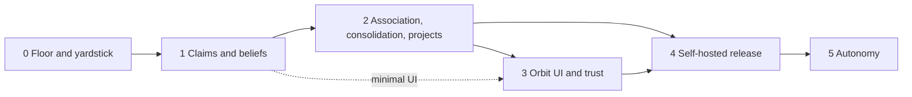

# 17 · Roadmap, risks and open questions

> **What this document decides:** the order of work, what "done" means for each phase, what could go wrong, and what is honestly not known.

## 1. Phases

Priorities follow the brief: the brain, then connectivity, then the interface, then autonomy. Connectivity and a minimal interface start early because the brain cannot be evaluated without real use. Durations are rough estimates for one or two engineers.

### Phase 0 — Floor and yardstick · ~6–8 weeks

Build the part that can never be wrong, and the means to measure everything after it.

| Build | Detail |
|---|---|
| Evidence ledger | Schema; admission with secret redaction and labels; idempotency; hash chain |
| Importers | The owner's own history: agent transcripts on disk, provider exports |
| Raw indexing | Lexical, dense, literal detection |
| Retrieval over evidence | `orbit_recall` and `orbit_exact` on a minimal single-user MCP server — this is Option C from [04](../research/04-architecture-options.md) |
| Evaluation harness | Invariants 1–3; OrbitBench generator at 100k and 1M tokens; LongMemEval-S under protocol; a first dogfood question set |

**Exit:** ledger invariants pass · baseline numbers recorded on every suite · the token-flow figures in [16](16-cost-and-scale.md) replaced by measurements · the owner uses it daily.

### Phase 1 — Claims and beliefs · ~8–12 weeks

| Build | Detail |
|---|---|
| Formation | Segmentation; salience tiers; anchor-verified extraction; handle-locked rendering |
| Model | Entities with soft identity; bitemporal beliefs; justification graph |
| Revision | Scope-Before-Supersede; slot replay; computed confidence; fast path |
| Retrieval | Slot channel; fusion; grounding gate and verdicts |
| Interface | `orbit_context`, `orbit_remember`, `orbit_correct`, `orbit_timeline`; OAuth and grants v1; capture hooks for the two agents the owner uses most |
| Engine | Ledger, API and revision in Rust |
| UI (minimal) | Browse belief → claims → quotes; correct; review queue |

**Exit:** better than Phase 0 on the Update, Temporal, Scope, Correction and Epistemic suites · invariants 4, 5, 6, 8, 9 pass · zero literal corruption.

### Phase 2 — Association, consolidation, projects · ~8–12 weeks

| Build | Detail |
|---|---|
| Graph | Projection; Typed Spreading Activation; episode completion |
| Consolidation | Sleep cycles N1–N3, then REM; views; Echo Guard; reconsolidation |
| Projects | Bindings; briefs and delta briefing; task packs; `AGENTS.md` import and export |
| Working and prospective memory | Workspace; `orbit_checkpoint`; intentions with triggers |
| Context | Budgeted weaver; resolution selection |
| Reach | LLM gateway; more connectors |
| Security | Firewall hardening; injection, poisoning and grant-leak suites |

**Exit:** better than Phase 1 on Multi-hop, Cross-client, Project and Rationale suites · each mechanism justified by its ablation or removed · security gates pass.

### Phase 3 — Orbit UI and trust

Memory explorer; knowledge-graph explorer; project dashboard; memory history; corrections; search; identity and preference management; grants and the disclosure ledger; export and delete. Android and desktop clients with the local replica and sync.

**Exit:** a non-author can inspect, correct, export and delete without help.

### Phase 4 — Self-hosted release

Everything up to here runs as the owner's own deployment in their cloud. This phase makes the same code deployable by someone else in theirs.

| Build | Detail |
|---|---|
| Packaging | One-command deploy; infrastructure-as-code for at least one cloud; container images |
| Guided setup | Domain and TLS, owner login, model keys, first import |
| Operations | Automatic schema migrations; versioned upgrades; scheduled backups; tested restore |
| Hardening | External security review; secure defaults; update notifications |
| Documentation | Install, operate, upgrade, recover |

**Exit:** a second person deploys, imports their history, upgrades once and restores from backup without help · OrbitBench at 100M tokens within gates on a single deployment · security review closed.

A hosted multi-user service (cells, per-user index bundles, confidential computing) is **not planned**. The seams that would make it an addition are listed in [12 §8](../system-design/12-system-design.md#8-deployment-model-and-upgrade-path).

### Phase 5 — Autonomy

The loop in the brief maps onto what will already exist:

| Step | Provided by memory | New in this phase |
|---|---|---|
| Observe | Capture connectors | Continuous observation, with consent controls |
| Understand | Extraction, entities | Intention recognition |
| Remember | Ledger, beliefs | — |
| Reason | Recall, views, identity model | Planner |
| Plan | Prospective memory: intentions, tasks, triggers | Goal decomposition |
| Execute | Grants, audit, elicitation for approval | Tool execution under capability control; credential brokering |
| Reflect | Outcomes captured as evidence (`agent` integrity); lessons as `inferred` procedure candidates | Outcome evaluation |
| Consolidate | Sleep cycles | — |

Two properties of the memory design exist for this phase: an agent's own conclusions enter at `agent` integrity and cannot rewrite who the user is, and every action can be explained by an as-of query against what Orbit believed when it acted.

## 2. The first two weeks

1. Create the ledger schema and the admission path; ingest one real conversation end to end.
2. Write the importer for the agent the owner uses most; import real history.
3. Stand up lexical search and the literal detector; answer an exact-recall question from real data.
4. Write the world simulator's first version: one persona, one project, twenty events, rendered to conversations.
5. Wire the invariant tests for INV-1 to INV-3 into CI.
6. Write fifty dogfood questions.

## 3. Risks

| Risk | Likelihood | Impact | Mitigation | Early signal |
|---|---|---|---|---|
| Small models cannot extract well enough, even verified | Medium | Cost × 10, or lower recall of derived memory | Mechanical verification; escalate only low-confidence, high-salience episodes; lazy extraction; raw retrieval as floor | Phase 0 extraction precision / recall by model |
| The design is more than the problem needs | Medium | Time; fragility | Strict phase order; every layer must beat the one below; ablations delete what does not pay | Phase 1 fails to beat Phase 0 on its target suites |
| Capture gaps in closed clients | High | Incomplete memory | Several channels; imports; the gateway; be explicit with users about coverage | Share of sessions with no captured evidence |
| Connected models do not call the tools | High | Recall and writes happen unpredictably | Deterministic capture and priming (hooks, resources, gateway); short, clear tool descriptions; `orbit_context` as the single entry point | Tool-call rates in scripted sessions |
| Wrong entity merges | Medium | Silent cross-contamination | Soft identity; user constraints; confusable registry; false-merge metric | False-merge rate |
| Wrong scope inference | Medium | Spurious exceptions or missed supersession | Conservative scope extraction; review of scope changes on high-impact kinds | Scope suite |
| Popularity loops in ranking | Medium | Old favourites crowd out better memories | Reinforce on *use*, capped; importance floor; exploration in associative mode | Rank concentration over time |
| Wrong or unwelcome inferences about the person | Medium | Loss of trust | Inferences never served as fact; sensitive categories never inferred; review queue | Review rejection rate |
| A model obeys injected text despite labels | Medium | Harmful action by a connected agent | Structural exclusion first; labels exported for client-side enforcement; grants bound damage | Injection suite attack success |
| Heavy users or large imports blow the budget | Medium | Margin | Per-user budgets; tier downgrade under pressure; usage-aware pricing | Cost per user distribution |
| MCP keeps changing; clients lag | High | Integration work | Thin protocol façade; compatibility layer for earlier revisions | Client compatibility matrix |
| Legal exposure: third-party data, recordings, residency | Medium | Launch blocker in some regions | Legal review before releasing to others; conservative defaults; each owner chooses their own region | — |
| Overfitting to a self-made benchmark | Medium | False confidence | Held-out simulated worlds; public benchmarks; the dogfood set | Gap between OrbitBench and dogfood results |
| One builder, large scope | High | Schedule | Phase 0 is small and useful alone; nothing in a later phase is needed to benefit from an earlier one | — |

## 4. Limitations

- **It cannot remember what it never captured.** "Perfect memory" is bounded by capture coverage.
- **Verification catches fabrication, not misinterpretation.** A claim can be anchored, entailed and still miss what the user meant. Corrections are the remedy.
- **Abstention trades coverage for accuracy.** A system tuned to almost never invent will sometimes say "not found" about something it holds.
- **Views are a little behind.** Minutes to a day, by design.
- **The server reads what it stores.** In a personal deployment that server is the owner's; the cloud host and configured model providers are still trusted parties ([11 §6](../architecture/11-security-privacy.md#6-encryption-and-keys)).
- **None of this has been built or measured.** The mechanisms marked *Hypothesis* are designs with tests attached; the numbers in [15](15-evaluation.md) and [16](16-cost-and-scale.md) are targets and estimates.

## 5. Unresolved research questions

1. **Calibrating recall confidence.** How well can "I don't have that" be predicted from retrieval features alone, across scales?
2. **Learning edge weights without feedback loops.** Implicit signals (was it used?) are biased toward what was shown.
3. **Scope.** Can the scope lattice be learned from usage rather than extracted per claim?
4. **Salience at scale.** Where do the tier thresholds sit at 10⁸ tokens, and how much does lazy extraction save in practice?
5. **When to ask the user.** A principled interruption budget — expected value of a question against its cost.
6. **Long-horizon summaries.** Do hierarchical views drift after years of regeneration? Should some be structured data instead of prose?
7. **Identity over time.** Telling growth from noise without freezing a caricature of who someone was.
8. **Measuring association.** What makes an unexpected connection *good*? Precision is not the right metric for serendipity.
9. **Multilingual and code-mixed input.** Entity resolution across scripts; embedding quality; verbatim preservation is language-neutral, interpretation is not.
10. **Multimodal evidence.** Anchoring to regions of images, audio and screen captures rather than byte spans.
11. **Confidential consolidation.** Running frontier-quality consolidation without the provider seeing plaintext.
12. **Shared brains.** Compartments that span people, for teams and families.
13. **Fidelity as a model of the owner.** Held-out decision prediction, normalised by the owner's own consistency.

## 6. Decisions needed from the owner

| Decision | Default assumed in these documents |
|---|---|
| Engine language | Rust, with Python for model pipelines |
| Where the brain lives | **Decided:** the owner's own cloud deployment, one brain per deployment; later, others deploy the same code in their cloud |
| Which clients to integrate first | The two agents used most, by hooks; then MCP broadly |
| Confidentiality | The owner operates the deployment; encryption at rest with keys in the owner's cloud KMS |
| Who the users are | **Decided:** the owner alone until it fully works; then self-hosters |
